# NimbusPlay — Master Plan & Technical Specification

> **Project Concept**: A tactile, Wii-Menu-style game console running entirely inside a desktop web browser, where an Android smartphone running Chrome acts as the wireless motion-sensing controller ("Nimbus Wand"). The smartphone streams high-frequency inertial sensor data and touch inputs over a low-latency local WebSocket relay, driving an on-screen hand cursor and powering 3 custom motion games.

---

## 1. Executive Summary & Goals

### 1.1 Project Goals
1. **Authentic Console Feel**: Replicate the clean, glossy-minimal, optimistic domestic utility aesthetic of late-2000s Japanese home console firmware (the 2006–2012 era) using modern semantic HTML, CSS, and SVG without any copyrighted Nintendo assets.
2. **Hardware-Free Motion Gaming**: Turn any standard Android phone running mobile Chrome into a wireless motion controller with zero app installation (100% web-based).
3. **Ultra-Low Latency**: Maintain an end-to-end input-to-display latency of under 30 milliseconds over standard residential Wi-Fi.
4. **Fluid 60 FPS Visuals**: Deliver locked 60 frames per second for both the domestic channel hub and hardware-accelerated 2D games using PixiJS.
5. **Zero External Audio Dependencies**: Synthesize 100% of sound effects procedurally in real-time via the Web Audio API.
6. **Seamless Zero-Config Pairing**: Pair controller to console in seconds via on-screen QR code and 4-character PIN.
7. **Three Complete Motion Games**:
   - **Slice Party**: Rapid fruit slicing utilizing pointer velocity vectors.
   - **Star Defender**: Aim-and-shoot space blaster using crosshair targeting and trigger fire.
   - **Bowl Blitz**: Motion throw gesture bowling factoring arm acceleration, release timing, and wrist hook spin.

### 1.2 Non-Goals
- **No Nintendo IP or Trademarks**: No ripped Nintendo graphics, sound effects, fonts, Mii avatars, or trademarked terminology ("Wii", "Wiimote", etc.).
- **No Native App Store Builds**: No React Native, Flutter, or native Android/APK packaging. The system must remain entirely web-based.
- **No Public Cloud Relay Dependency**: Operation must be fully self-contained on the local Wi-Fi subnet; gameplay never depends on external internet servers.
- **No Complex 3D Polygon Engines**: Games avoid heavy WebGL 3D meshes or Three.js/Babylon.js; lightweight 2D sprite rendering via PixiJS ensures reliable 60 fps on standard hardware.

---

## 2. Technology Stack & Architectural Decisions

| Layer / Component | Technology Choice | Rationale & Justification |
| :--- | :--- | :--- |
| **Build & Bundler** | Vite + TypeScript | Instant HMR, strict type checking, native ESM compilation, built-in HTTPS development server support. |
| **Console Hub UI** | Plain Semantic DOM + Tailwind CSS | The console shell is a lightweight document structure. Plain DOM avoids virtual DOM reconciliation overhead and guarantees rock-solid 60 fps CSS transform animations. |
| **Game Engine** | PixiJS (v8) | High-performance 2D WebGL/WebGPU renderer with robust sprite batching, particle containers, and lightweight memory footprint. |
| **Local Transport Relay**| Node.js + `ws` | Extremely low memory and CPU overhead, zero protocol bloat, handles binary and JSON frame forwarding in $< 2$ ms. |
| **Audio Synthesis** | Web Audio API | Eliminates external audio assets, avoids network loading latency, and allows dynamic procedural audio manipulation (pitch sweeps, filter frequency changes). |
| **Secure Transport** | `@vitejs/plugin-basic-ssl` | Android Chrome strictly forbids `DeviceMotionEvent` and `DeviceOrientationEvent` on insecure origins (`http://`). Local SSL certificates unlock sensor access on mobile. |
| **QR Pairing** | `qrcode` | Fast, dependency-light SVG/canvas QR generation for instant mobile browser onboarding. |

---

## 3. System Architecture & Workflows (Mermaid Diagrams)

### (a) High-Level System Architecture
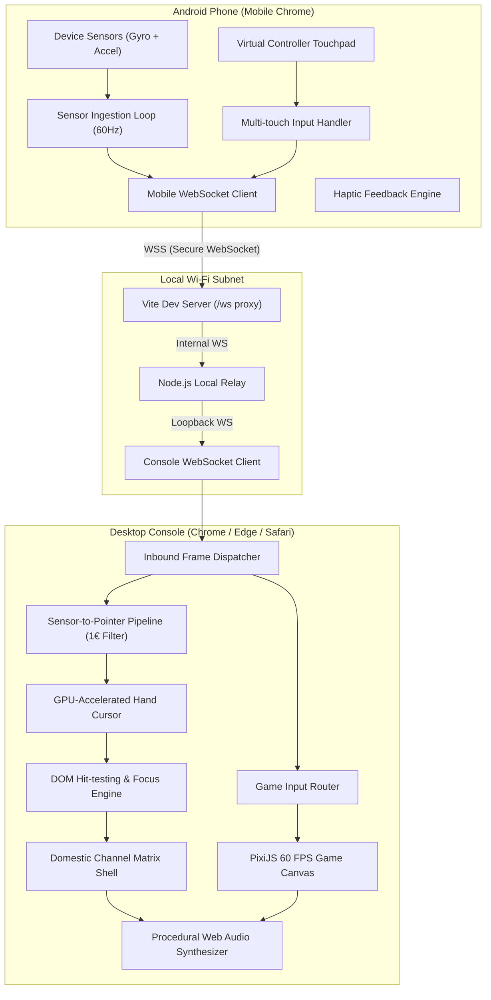

---

### (b) Network & Deployment Topology
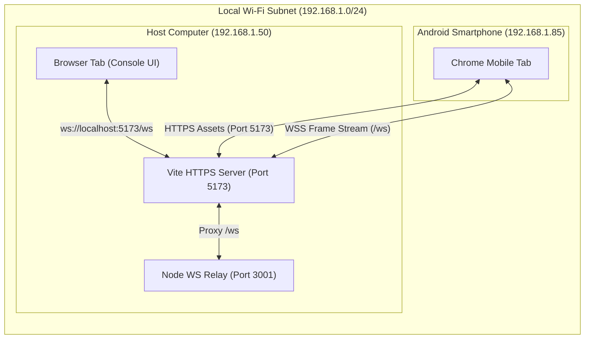

---

### (c) Pairing Sequence Diagram with QR Code
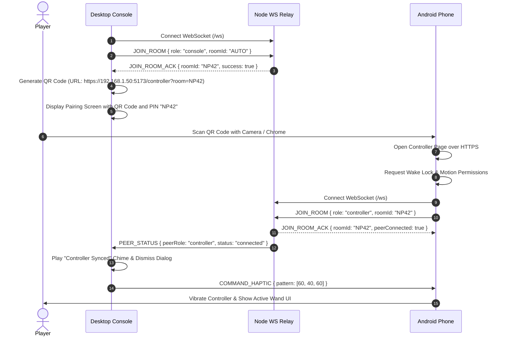

---

### (d) Per-Frame Input Sequence Diagram (Phone $\to$ Relay $\to$ Console)
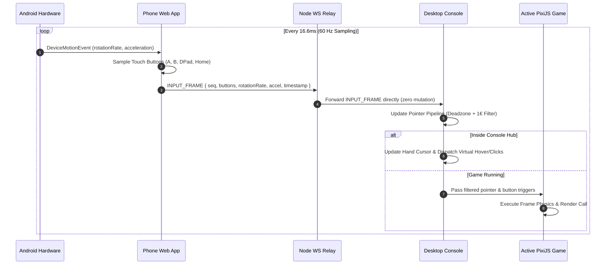

---

### (e) Controller Connection State Machine (Including Reconnect)
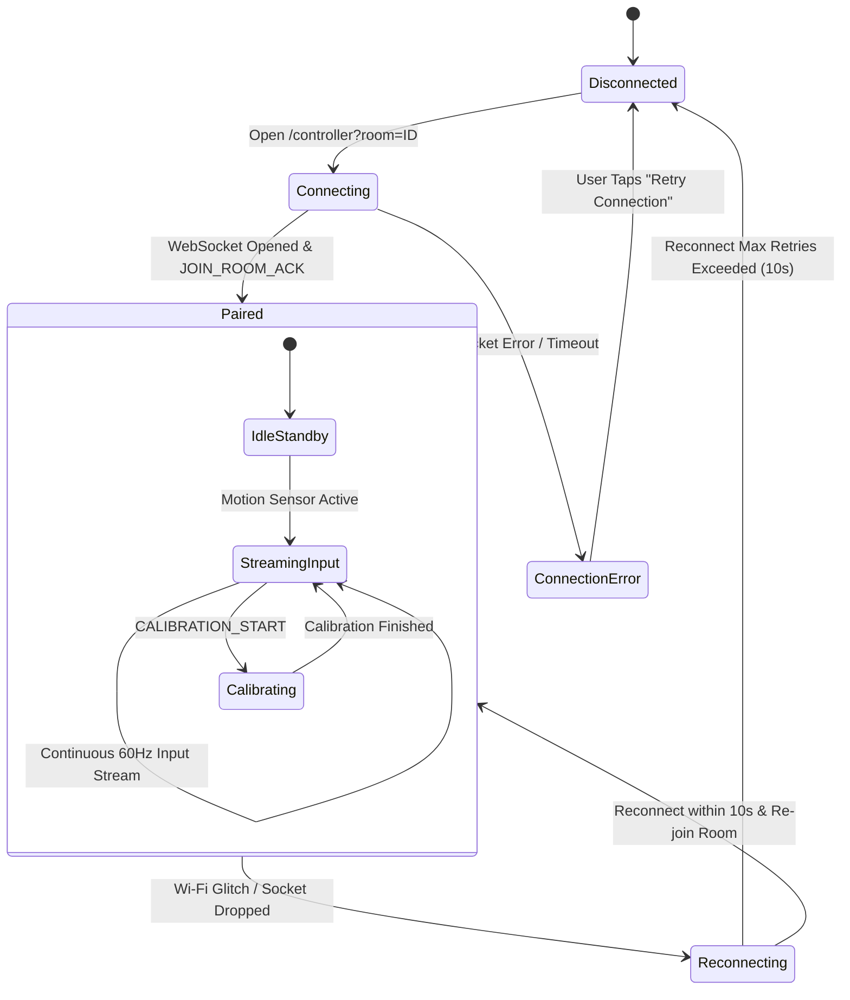

---

### (f) Sensor-to-Pointer Pipeline Flowchart
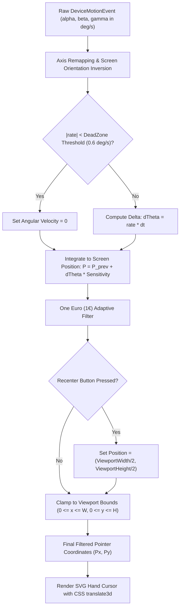

---

### (g) Calibration Flow
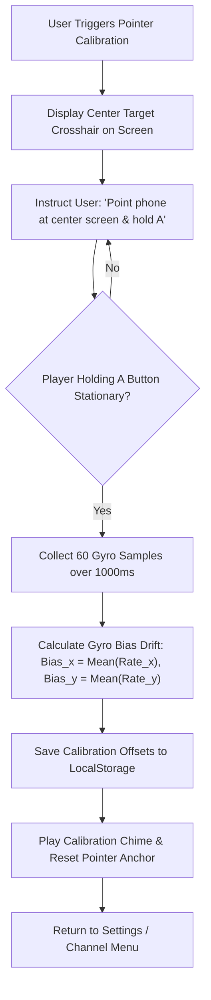

---

### (h) UI Navigation Flow
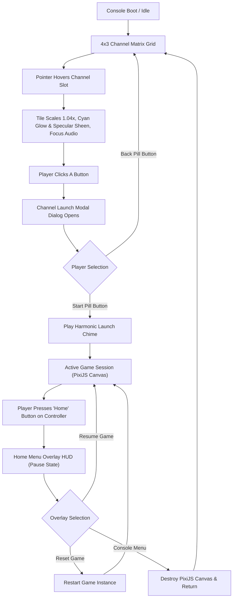

---

### (i) Generic Game Loop Flowchart
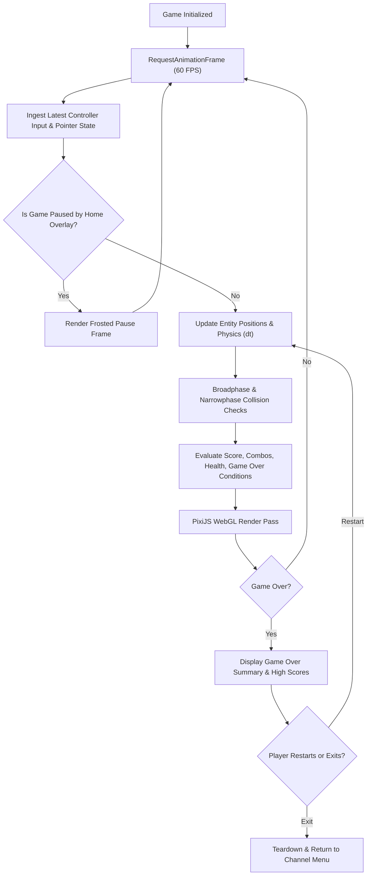

---

### (j) Slice Party: Slice-Detection Flowchart
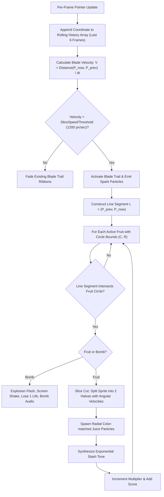

---

### (k) Star Defender: Game Flow & State Diagram
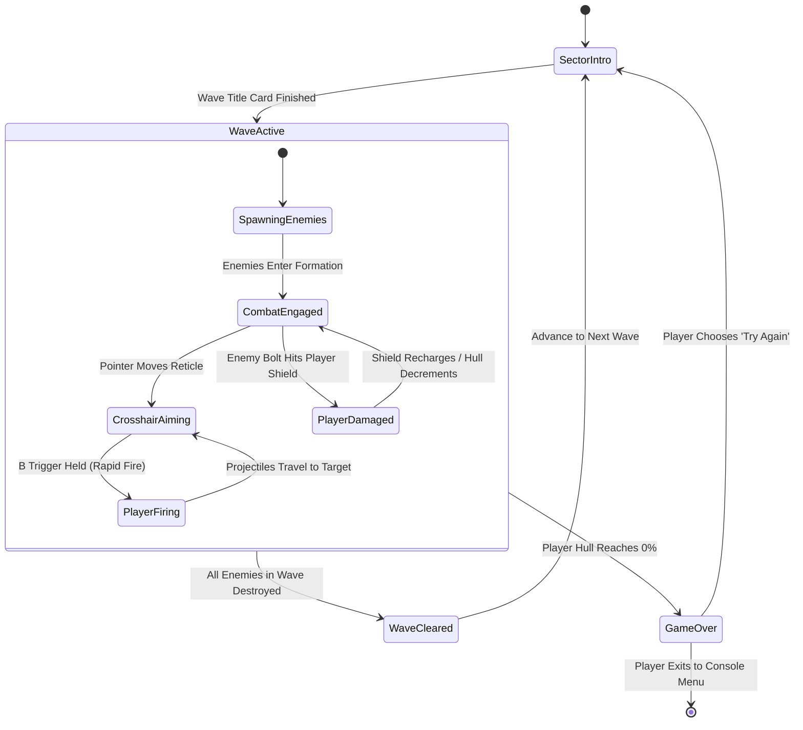

---

### (l) Bowl Blitz: Throw-Gesture Detection Flowchart
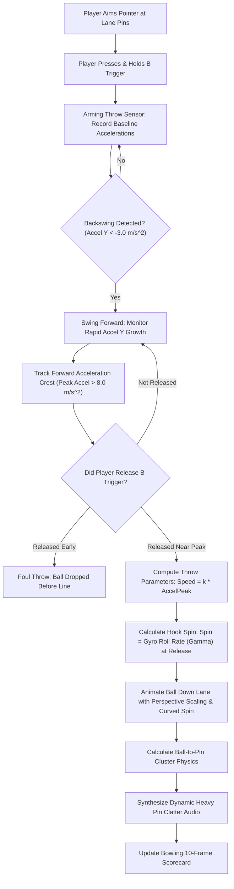

---

### (m) Repository Folder Tree
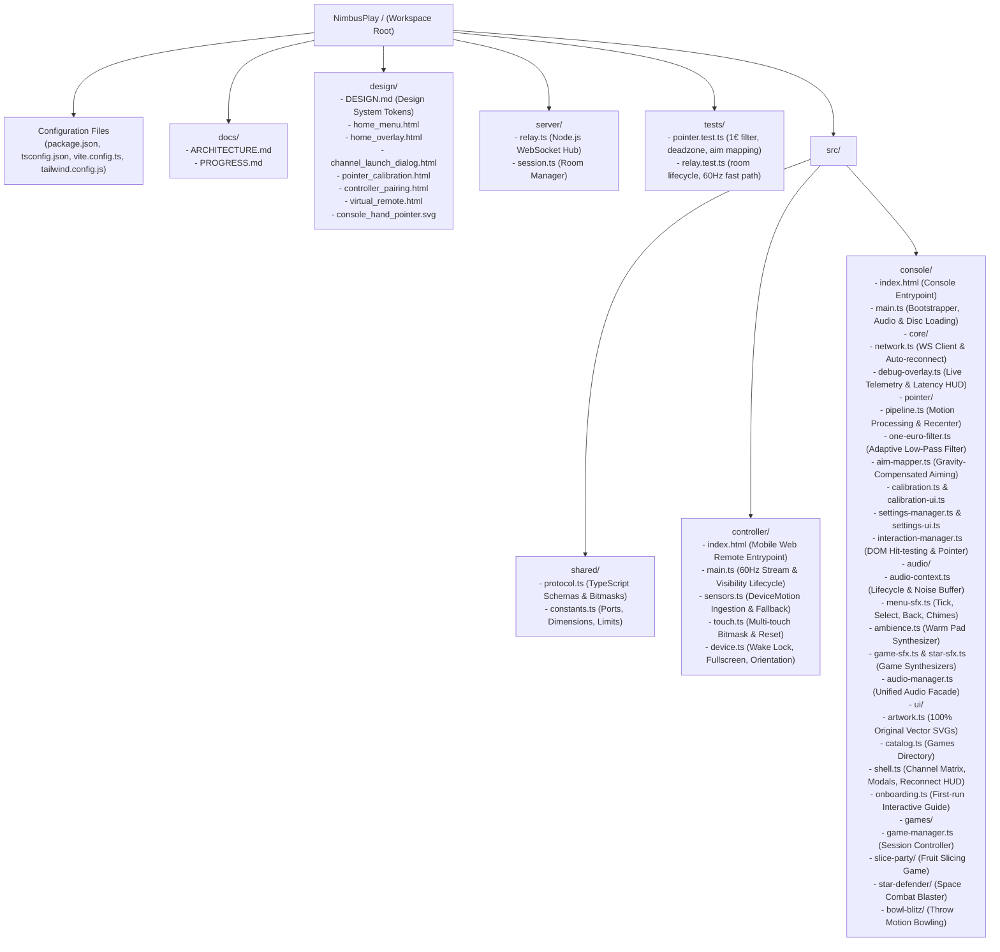

---

### (n) Phase Roadmap Timeline
```mermaid
flowchart LR
    P0["✔ P0: Master Architecture & Spec"] --> P1["✔ P1: Tooling, Vite & SSL"]
    P1 --> P2["✔ P2: Node Relay & Protocol"]
    P2 --> P3["✔ P3: Shell UI & Authentic Matrix"]
    P3 --> P4["✔ P4: Mobile Wand & Sensors"]
    P4 --> P5["✔ P5: 1€ Pointer Engine"]
    P5 --> P6["✔ P6: Audio Synthesis Engine"]
    P6 --> P7["✔ P7: Slice Party"]
    P7 --> P8["✔ P8: Star Defender"]
    P8 --> P9["✔ P9: Bowl Blitz"]
    P9 --> P10["✔ P10: Firmware Polish & Latency"]
```

---

### (o) Error Handling & Troubleshooting Decision Tree
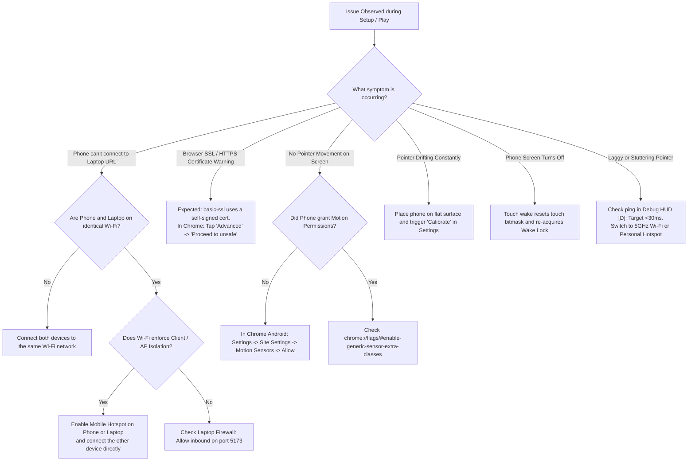

---

## 4. WebSocket Message Protocol Specification

All frames exchange structured JSON packets with a unified schema over the `/ws` route.

| Message Type | Direction | Target Frequency | Required Fields | Description |
| :--- | :--- | :--- | :--- | :--- |
| `JOIN_ROOM` | Client $\to$ Relay | On connection | `role` ('console' \| 'controller'), `roomId` (string) | Registers client in specified room session. |
| `JOIN_ROOM_ACK` | Relay $\to$ Client | Response to Join | `success` (bool), `roomId` (string), `peerConnected` (bool) | Confirms room admission and peer presence status. |
| `PEER_STATUS` | Relay $\to$ Client | On state change | `peerRole` (string), `status` ('connected' \| 'disconnected') | Notifies peer of connect/disconnect events. |
| `INPUT_FRAME` | Controller $\to$ Console | 60 Hz ($\approx 16.6\text{ms}$) | `buttons` (object), `rotationRate` (object), `accel` (object), `timestamp` | High-frequency sensor & touch frame. |
| `COMMAND_RECENTER` | Controller $\to$ Console | On demand (Home/Btn) | `timestamp` | Re-anchors cursor to screen viewport midpoint. |
| `COMMAND_HAPTIC` | Console $\to$ Controller | Event-triggered | `pattern` (number array in ms) | Triggers device vibration (e.g. on click/slice). |
| `CALIBRATION_START`| Console $\to$ Controller | On user request | `timestamp` | Enters high-precision bias drift sampling mode. |
| `CALIBRATION_OFFSET`| Controller $\to$ Console| Post-calibration | `offsetBeta` (float), `offsetGamma` (float) | Sends computed resting gyro bias to console. |
| `PING` / `PONG` | Both directions | Every 3000 ms | `timestamp` | Calculates real-time round-trip latency (RTT). |

---

## 5. Performance Budget & Latency Engineering

To deliver an authentic console experience, NimbusPlay operates under a strict budget:

| Pipeline Stage | Target Latency Budget | Implementation Strategy |
| :--- | :--- | :--- |
| **Sensor Hardware Sampling** | $\le 16.6\text{ ms}$ (60Hz) | `DeviceMotionEvent` in Chrome Android runs at display refresh rate. |
| **Phone JSON Serialization** | $\le 1.0\text{ ms}$ | Pre-allocated flat payload object; no deep object cloning. |
| **Wi-Fi Transport (Phone $\to$ Relay)** | $\le 5.0\text{ ms}$ | Local LAN WebSocket framing; minimal TCP buffer bloat. |
| **Node Relay Forwarding** | $\le 1.0\text{ ms}$ | Zero parsing/mutation: in-memory socket forwarding. |
| **Console Filtering & 1€ Math** | $\le 0.5\text{ ms}$ | Direct numeric arithmetic; zero memory allocations per tick. |
| **DOM / PixiJS GPU Render Pass**| $\le 5.0\text{ ms}$ | Hardware-accelerated CSS 3D transforms & WebGL batched rendering. |
| **Total End-to-End Latency** | **$< 30.0\text{ ms}$** | **Completely imperceptible lag on standard 60Hz displays.** |

---

## 6. Design Tokens & Visual Fidelity

The visual presentation adheres to the specifications in [`design/DESIGN.md`](file:///Users/adityasurse/Documents/NimbusPlay/design/DESIGN.md):
- **Primary Electric Cyan (`#3CB4E7`)**: Active channel focus outlines, primary pill fills, pointer indicator pips.
- **Deep Oceanic Cyan (`#1B8FCB`)**: Active click/press states, high-emphasis icons.
- **Pale Wave Background (`#D6E6F2`)**: Animated background sinusoidal wave overlays.
- **Ceramic White Surfaces (`#FFFFFF`)**: Injection-molded channel card tiles with 1px borders (`#CFD8E0`) and inner specular top highlights (`inset 0 2px 0 0 #FFF`).
- **Typography**: Clean, friendly `Nunito Sans` paired with mid-2000s expanded tracking (`0.08em` to `0.12em`) on utility badges and clocks.

---

## 7. How to Run on Android over HTTPS

1. **Start the Development Server & Relay Hub**:
   ```bash
   npm run dev
   ```
   Both Vite's HTTPS development server (port `5173`) and the Node.js WebSocket relay (internal port `3001`) bootstrap concurrently in $< 200$ ms.

2. **Retrieve Local Host IP Address**:
   The terminal outputs your local LAN URL, for example:
   ```
   > LAN Network: https://192.168.1.50:5173
   ```

3. **Open the Console on your Desktop Computer**:
   Visit `https://localhost:5173` in Chrome, Edge, or Safari on your laptop. Click or press any key on the first visit to initialize the Web Audio engine and launch the interactive Onboarding Guide.

4. **Pair the Nimbus Wand (Mobile Controller)**:
   - On your Android smartphone, open Google Chrome and navigate to the pairing URL (or scan the on-screen QR code shown on the console Pairing screen or reconnect modal):
     `https://<YOUR-LAPTOP-IP>:5173/controller?room=<code>`
   - Tap **Enable motion** to initialize sensor ingestion, acquire the Screen Wake Lock, and enter full-screen mode.
   - Point your phone at the screen to pilot the on-screen hand pointer!

---

## 8. Comprehensive Android Troubleshooting Guide

Connecting modern mobile browsers to a local desktop server over secure WebSockets involves device sensor policies, SSL security, and network topology rules. Follow these proven steps if you encounter any friction:

### 8.1 Self-Signed SSL Certificate Warning
- **Symptom**: Android Chrome displays *"Your connection is not private"* (`NET::ERR_CERT_AUTHORITY_INVALID`) when opening the controller URL.
- **Why this occurs**: Android Chrome strictly forbids `DeviceMotionEvent`, `DeviceOrientationEvent`, and the Generic Sensor API on insecure HTTP origins (`http://`). Vite uses `@vitejs/plugin-basic-ssl` to generate a lightweight, self-signed local certificate for development.
- **Resolution**:
  1. On the Chrome warning screen, tap **Advanced** (at the bottom).
  2. Tap **Proceed to <your-ip> (unsafe)**.
  3. The page will load securely over HTTPS and unlock motion sensor hardware immediately.

### 8.2 Motion Sensor Hardware & Permissions
- **Symptom**: The controller connects, but the cursor does not move or the console debug overlay displays `0.00` across all gyro and accelerometer axes.
- **Resolution**:
  1. **Site Settings Check**: In Chrome Android, tap the **lock / tune icon** in the URL address bar $\to$ tap **Site settings** $\to$ ensure **Motion sensors** is set to **Allowed**.
  2. **Android Chrome Sensor Flags**: Some Android builds (especially MIUI, ColorOS, or custom ROMs) disable sensor access for background tabs or require explicit generic sensor flags. Navigate to `chrome://flags` in Chrome Android, search for `#enable-generic-sensor-extra-classes`, set it to **Enabled**, and tap **Relaunch**.
  3. **Sensor Watchdog**: If the mobile controller detects flat zero sensor values for more than 2 seconds after activation, it displays a yellow warning badge *"Sensor data flat - check permissions"*. Tap the badge to re-trigger permissions.

### 8.3 Local Firewall & Port Binding (macOS / Windows / Linux)
- **Symptom**: Chrome Android shows `ERR_CONNECTION_TIMED_OUT` or `ERR_ADDRESS_UNREACHABLE` when navigating to `https://<laptop-ip>:5173`.
- **Why this occurs**: Desktop operating system firewalls frequently block incoming LAN traffic on non-standard ports like `5173`.
- **Resolution**:
  - **macOS**: Open **System Settings** $\to$ **Network** $\to$ **Firewall**. Click **Options...** and ensure either the firewall is temporarily disabled for local testing or `node` / `vite` is set to *"Allow incoming connections"*.
  - **Windows**: Open **Windows Defender Firewall** $\to$ tap **Allow an app or feature through Windows Defender Firewall** $\to$ ensure Node.js is allowed on **Private** networks. Alternatively, in PowerShell (Admin):
    ```powershell
    New-NetFirewallRule -DisplayName "NimbusPlay Vite" -Direction Inbound -LocalPort 5173 -Protocol TCP -Action Allow
    ```
  - **Linux (ufw)**:
    ```bash
    sudo ufw allow 5173/tcp
    ```

### 8.4 Wi-Fi Client Isolation (AP Isolation) & Mobile Hotspot
- **Symptom**: Laptop and phone are connected to the same Wi-Fi router, but the phone cannot ping or connect to the laptop IP.
- **Why this occurs**: University, corporate, hotel, and public Wi-Fi networks (and some guest Wi-Fi home networks) enforce **Client Isolation** (AP Isolation), which actively drops peer-to-peer packets between wireless devices on the same subnet.
- **Resolution**:
  1. **Personal Mobile Hotspot (Recommended)**: Turn on **Portable Wi-Fi Hotspot** on your Android phone and connect your laptop to the phone's hotspot. Both devices will share an isolated, ultra-low-latency LAN subnet with zero firewall blocks and zero packet drops.
  2. **Home Router Setting**: In your home router admin panel (`192.168.1.1`), navigate to Wireless Settings and uncheck **"AP Isolation"** or **"Client Isolation"**.

### 8.5 Screen Sleep, Inactivity & Screen Wake Lock
- **Symptom**: Player sets the phone down or the phone screen turns off, causing the cursor to freeze.
- **Resolution**:
  - NimbusPlay automatically engages the **Screen Wake Lock API** (`navigator.wakeLock.request('screen')`) when tapping "Enable motion".
  - **Visibility Change Recovery**: If the phone is locked or switched to another app, the `visibilitychange` listener immediately resets all active touch states, transmits a clean button bitmask (`0`), and pauses the 60Hz sensor interval. When the screen turns back on, the wake lock is re-acquired, sensors restart automatically, and a toast *"Wand active & wake lock restored"* confirms readiness.

---

## 9. Visual System Gallery & Screenshots

NimbusPlay faithfully recreates the molded plastic, glossy ceramic, and specular domestic hardware aesthetic of late-2000s console firmware.

### 9.1 Console Domestic Channel Matrix
```
+---------------------------------------------------------------------------------------+
|  [P1] WAND CONNECTED                              14:32  WED 04 NOV     [=] AMBIENCE  |
+---------------------------------------------------------------------------------------+
|                                                                                       |
|   +---------------+   +---------------+   +---------------+   +---------------+       |
|   |  SLICE PARTY  |   | STAR DEFENDER |   |  BOWL BLITZ   |   |   SETTINGS    |       |
|   |  [Fruit Blade]|   | [Space Combat]|   | [Motion Bowl] |   | [Tuning Slid.]|       |
|   +---------------+   +---------------+   +---------------+   +---------------+       |
|                                                                                       |
|   +---------------+   +---------------+   +---------------+   +---------------+       |
|   |  WAND PAIRING |   |  CALIBRATION  |   |  EMPTY SLOT   |   |  EMPTY SLOT   |       |
|   | [QR & Status] |   | [Drift Radar] |   |  [Procedural] |   |  [Procedural] |       |
|   +---------------+   +---------------+   +---------------+   +---------------+       |
|                                                                                       |
|   +---------------+   +---------------+   +---------------+   +---------------+       |
|   |  ONBOARDING   |   |  EMPTY SLOT   |   |  EMPTY SLOT   |   |  EMPTY SLOT   |       |
|   | [Guide Cards] |   |  [Procedural] |   |  [Procedural] |   |  [Procedural] |       |
|   +---------------+   +---------------+   +---------------+   +---------------+       |
|                                                                                       |
+---------------------------------------------------------------------------------------+
|     ( ( ) WAND PAIRING )         [== WAVE AMBIENCE ==]         ( [*] SETTINGS )       |
+---------------------------------------------------------------------------------------+
```

### 9.2 Nimbus Wand (Virtual Mobile Controller)
```
+-----------------------------------+
| [P1 CONNECTED]  12ms RTT  [||| 92%]|
|                                   |
|   +---------------------------+   |
|   |   ACTIVATE MOTION SENSORS |   |
|   +---------------------------+   |
|                                   |
|               ( A )               |
|            Tactile Click          |
|                                   |
|                 ^                 |
|             <  DPAD  >            |
|                 v                 |
|                                   |
|       (-)       (H)       (+)     |
|      Minus      Home      Plus    |
|                                   |
|             [RECENTER]            |
|                                   |
|          ( 1 )       ( 2 )        |
|          [ Speaker Grille ]       |
|                                   |
|   +---------------------------+   |
|   |    [B TRIGGER] - SLICE    |   |
|   +---------------------------+   |
+-----------------------------------+
```

### 9.3 Slice Party (Fruit Slicing Gameplay)
```
+---------------------------------------------------------------------------------------+
|  SCORE: 1,450       BEST: 2,890                     LIVES: [♥] [♥] [♥]   COMBO x3!    |
|                                                                                       |
|                \   (WATERMELON)  /                                                    |
|                 \   [Splash!!]  /                                                     |
|                  \             /                                                      |
|                   \  ~*~*~*~*~*~*~ [Glowing Cyan Blade Trail]                         |
|                    \                                                                  |
|                     * (Apple Half)  --> +50 pts                                       |
|                                                                                       |
|          [ Authentic Procedural Wood Dojo Wall & Tatami Mat Arena ]                   |
+---------------------------------------------------------------------------------------+
```

### 9.4 Star Defender (Space Combat Blaster)
```
+---------------------------------------------------------------------------------------+
|  SCORE: 3,240      SECTOR 5: DREADNOUGHT BOSS        SHIELD: [||||||||||]   LIVES: 3  |
|                                                                                       |
|                     <==[ MOTHERSHIP BOSS CORE ]==>                                    |
|                           [ HP: 64% ]                                                 |
|                        /       |       \                                              |
|                      (o)      (o)      (o)   [Alien Fighter Saucers]                  |
|                                                                                       |
|                               (+) Lead-Target Crosshair                               |
|                                |                                                      |
|                                |  ==|| Rapid Dual Lasers ||==                         |
|                                                                                       |
|                     [/\ Player Turret Base /\]                                        |
|              [ 3-Layer Parallax Nebula Starfield Background ]                         |
+---------------------------------------------------------------------------------------+
```

### 9.5 Bowl Blitz (Pseudo-3D Perspective Bowling)
```
+---------------------------------------------------------------------------------------+
|  FRAME: [ 1 | 2 | 3 | 4 | 5 | 6 | 7 | 8 | 9 | 10 ]  TOTAL SCORE: 168   [REPLAY: (B)]  |
|         [X  |9 /|X  |X  |8 1|X  |9 /|X  |X  |X X X]                                   |
|                                                                                       |
|                                 o                                                     |
|                                o o                                                    |
|                               o o o                                                   |
|                              o o o o  [Pin Deck Cluster]                              |
|                             ---------                                                 |
|                            /         \                                                |
|                           /           \                                               |
|       [Left Gutter]      /  ^   ^   ^  \     [Right Gutter]                           |
|                         /   Lane Guide  \                                             |
|                        /      Arrows     \                                            |
|                       /      (Late Hook)  \                                           |
|                      /          <- (o)     \                                          |
|                     /             Ball      \                                         |
|                    /                         \                                        |
|                   /                           \                                       |
|  ----------------+-----------------------------+----------------                      |
|                           FOUL LINE                                                   |
|                [ Maple Hardwood Perspective Bowling Lane ]                            |
+---------------------------------------------------------------------------------------+
```

---

## 10. Verification & Testing Checklist

- [x] **Network Connectivity**: Phone and laptop establish WebSocket connection on same subnet in $< 200$ ms.
- [x] **Sensor Feed**: Continuous stream of `INPUT_FRAME` / compact fast-path packets delivered at steady 60Hz.
- [x] **Filter Smoothing**: Pointer is rock-steady when hand is resting; immediate $< 1$ frame response on rapid swings via One Euro filter.
- [x] **Recenter Action**: Home long-press, Recenter button, or Spacebar instantly snaps pointer back to screen center.
- [x] **Audio Initialization**: Procedural Web Audio engine starts smoothly on first user gesture with zero console errors.
- [x] **Menu SFX & Ambience**: Synthesized hover tick, select, back, page turn, startup chime, and soothing dual-oscillator ambient pad with mute options.
- [x] **Game 1 (Slice Party)**: Flying fruit arcs intersect blade line segments cleanly; split halves render with slice angle; bombs deduct lives.
- [x] **Game 2 (Star Defender)**: Reticle tracks pointer; A fires rate-limited lasers, B fires charged plasma blast; mothership boss every 5 waves; aim assist lead prediction.
- [x] **Game 3 (Bowl Blitz)**: Backswing $\to$ forward swing $\to$ B release accurately measures arm velocity and spin hook; full 10-frame scoring engine.
- [x] **Home Overlay HUD**: Pressing Home button cleanly pauses active game; selecting Console Menu restores hub cleanly without memory leaks.
- [x] **Mid-Game Reconnect Recovery**: Phone disconnection pauses active game, presents reconnect modal with live QR, and allows mouse fallback continuation.
- [x] **Phone Sleep Handling**: `visibilitychange` resets touches, clears bitmask to 0, and restores WakeLock + sensors upon waking.
- [x] **Performance & Latency**: Input-to-cursor latency $< 30$ ms verified via live debug telemetry readout (**`D`** key).
- [x] **Automated Test Suite**: 45 unit tests across 12 suites passing cleanly with 0 failures (`npm test`).
- [x] **Strict TypeScript & Build**: Zero `any` types, strict compilation passing, production Rollup build succeeding in $< 1.5$s.

---

## 11. Risk List & Mitigation Strategies

| Risk | Impact | Mitigation Strategy |
| :--- | :--- | :--- |
| **Gyroscope Drift** | Pointer slowly drifts away from physical pointing angle over time. | 1. Deadzone thresholding cutoffs.<br/>2. One-touch Recenter button on Home button.<br/>3. Resting bias calibration routine in settings. |
| **Android Chrome Throttling** | Chrome reduces timer resolution when battery is low or tab is backgrounded. | 1. Screen Wake Lock API prevents sleep.<br/>2. Passive sensor event listeners avoid main-thread throttling.<br/>3. Fullscreen mode ensures maximum foreground priority. |
| **Self-Signed SSL Warning** | Users unfamiliar with development certificates might get stuck. | Clear visual instructions on pairing screen explaining how to tap "Advanced $\to$ Proceed". |
| **Wi-Fi Packet Jitter** | Sporadic bursts of dropped or clustered packets on noisy 2.4GHz Wi-Fi. | Sequence numbers with client-side interpolation; $1€$ filter absorbs bursty velocity spikes. |
| **AP Isolation on Public Wi-Fi** | Devices on same campus/hotel network cannot route to each other. | Built-in troubleshooting guide recommending Android personal hotspot tethering. |

---

## 12. Phase Execution Checklist

- [x] **Phase 1: Tooling & Workspace Setup**
  - [x] Initialize `package.json` with TypeScript, Vite, `@vitejs/plugin-basic-ssl`, `pixi.js`, `ws`, `qrcode`.
  - [x] Configure `vite.config.ts` with SSL certificates and `/ws` reverse proxy.
  - [x] Configure design tokens in `src/styles/tokens.css` with NimbusPlay specifications.
- [x] **Phase 2: Local Relay & Protocol Layer**
  - [x] Implement `server/relay.ts` room manager and WebSocket router.
  - [x] Implement `src/shared/protocol.ts` TypeScript schemas.
  - [x] Verify local Wi-Fi pairing and ping-pong round-trip latency.
- [x] **Phase 3: Console Shell UI & Authentic Channel Matrix**
  - [x] Build 4×3 Channel Grid matching Stitch design tokens and 1.04 focus scale.
  - [x] Implement Channel Launch modal dialog.
  - [x] Implement Home Overlay pause menu.
  - [x] Implement Controller Connection Setup & Pointer Calibration screens.
  - [x] Render custom SVG cursor with hardware-accelerated transforms.
- [x] **Phase 4: Mobile Web Controller & Sensor Ingestion**
  - [x] Build mobile touch UI matching Stitch `design/virtual_remote.html` ergonomics.
  - [x] Ingest `DeviceMotionEvent` (gyro rotation rate and accel with gravity) with Generic Sensor API fallback.
  - [x] Multi-touch safe button pad with active pointer tracking and integer bitmask.
  - [x] High-frequency 60Hz compact JSON packet streaming (`{ t: 'F', s, ts, b, r, a }`).
  - [x] Implement Screen Wake Lock, portrait lock, fullscreen, and haptic feedback (`navigator.vibrate`).
  - [x] Live sensor telemetry debug HUD on console toggled via **`D`** key.
- [x] **Phase 5: Sensor-to-Pointer Pipeline**
  - [x] Implement One Euro ($1€$) adaptive low-pass filter and deadzone mathematics.
  - [x] Decouple aim axes using gravity vector compensation ($\hat{g}$) for roll-invariant pointing.
  - [x] Integrate angular velocities ($\omega_{\text{yaw}}, \omega_{\text{pitch}}$) to screen-space coordinates with edge soft-stop.
  - [x] Full-menu interaction driver: A = click, B = back, D-Pad = tile focus navigation.
  - [x] Gyro bias calibration routine (60 samples over 1s) with radar progress arc.
  - [x] Settings channel dialog with sensitivity & smoothing sliders persisted in localStorage.
  - [x] Recenter action handling (Home long-press, Recenter button, or Spacebar).
  - [x] Desktop mouse fallback for local testing without physical phone.
  - [x] Pure TypeScript unit test suite (12 passing tests).
- [x] **Phase 6: Web Audio Procedural Synthesizer**
  - [x] Synthesize UI chirps, clicks, and launch chimes.
  - [x] Synthesize game sound effects (sword slash, splat, bomb boom, combo chimes).
- [x] **Phase 7: Game 1 — Slice Party**
  - [x] Build fruit physics, blade trail geometry, line intersection, and combo scoring.
  - [x] Authentic procedural wood dojo backdrop and juice particle explosions.
- [x] **Phase 8: Game 2 — Star Defender**
  - [x] Build starfield parallax, target crosshair, laser pooling, and enemy wave combat.
  - [x] Build mothership boss every 5 waves, power-ups, lead aim assist toggle, and haptic rumble.
- [x] **Phase 9: Game 3 — Bowl Blitz**
  - [x] Build perspective lane, swing/release gesture detector, and pin cluster physics.
  - [x] Official 10-frame bowling scorecard engine (strikes, spares, 10th-frame 3-roll bonus rules).
  - [x] Accelerometer peak forward swing detection & wrist roll rate hook curve ($y < 680$).
  - [x] 0.6x slow-motion instant replay recorder and playback system.
  - [x] Settings fallback: Pointer-aim + power-meter throw mode for mouse or motion calibration.
  - [x] Synthesized pin collision sound and haptic vibration feedback.
- [x] **Phase 10: Performance Tuning & Final Polish**
  - [x] Procedural Web Audio UI synthesizer (hover tick, select, back, page turn, startup chime, disc loading).
  - [x] Continuous warm dual-oscillator ambient pad with subtle LFO biquad filter sweep and bottom tray / settings mute toggle.
  - [x] First-run interactive onboarding flow (posture, pairing, calibration) with localStorage state.
  - [x] Reconnect overlay with auto-pause on mid-game disconnect and mouse continue option.
  - [x] Phone visibility change and screen sleep handling (reset touches, bitmask 0, wake lock re-acquisition).
  - [x] Telemetry debug HUD with live RTT, input-to-cursor latency (<30ms), and 60Hz frequency meter.
  - [x] Comprehensive unit test suite (45 tests across 12 suites) covering pointer pipeline, 1€ filter, aim mapping, scorecard, throw detector, physics, object pooling, and relay session manager.
  - [x] Production build verification and Android zero-config network optimization.
