# NimbusPlay — Master Plan & Technical Specification (Game Remake)

> **Project Concept**: A tactile, Wii-Menu-style game console running entirely inside a desktop web browser, where an Android smartphone running Chrome acts as the wireless motion-sensing controller ("Nimbus Wand"). The smartphone streams high-frequency inertial sensor data and touch inputs over a low-latency local WebSocket relay, driving an on-screen hand cursor and powering **4 custom motion games** based on the reference system (`/design/reference/Video-7889.mp4`, `reel-games.png`, and `reel-menu.png`): **Fruit Ninja**, **Alien Attack**, **Shooting Range**, and **Sketch**.

---

## 1. Executive Summary & Goals

### 1.1 Project Goals
1. **Authentic Console Feel**: Replicate the clean, glossy-minimal, optimistic domestic utility aesthetic of late-2000s Japanese home console firmware (the 2006–2012 era) using modern semantic HTML, CSS, and SVG without any copyrighted Nintendo assets.
2. **Hardware-Free Motion Gaming**: Turn any standard Android phone running mobile Chrome into a wireless motion controller with zero app installation (100% web-based).
3. **Ultra-Low Latency**: Maintain an end-to-end input-to-display latency of under 30 milliseconds over standard residential Wi-Fi.
4. **Fluid 60 FPS Visuals**: Deliver locked 60 frames per second for both the domestic channel hub and hardware-accelerated games using PixiJS.
5. **Zero External Audio Dependencies**: Synthesize 100% of sound effects procedurally in real-time via the Web Audio API.
6. **Seamless Zero-Config Pairing**: Pair controller to console in seconds via on-screen QR code embedded directly into the console firmware bottom shelf.
7. **Five Original Motion Games (Reference Target)**:
   - **Fruit Ninja**: High-speed fruit slicing on vertical cedar wood planks with luminous blade ribbons, juicy wall splatters, watermelon score HUD, and 3-strike `X X X` life counters.
   - **Alien Attack**: 3D forward rail-shooter through deep space warp corridors, nebula clouds, and Saturn-like ringed gas giants, controlled via **two-handed landscape phone tilt steering and dual-thumb laser firing**.
   - **Shooting Range**: Sunny daytime carnival target range with drifting clouds, lush green grass hill, pop-up animated concentric ring bullseyes (red, orange, black), and hitscan trigger fire with floating score text.
   - **Sketch**: Real-time creative digital whiteboard with vertical multi-color swatch palette, brush size selectors, and smooth Catmull-Rom vector ink drawing with **A** button held.
   - **Turbo Circuit**: High-octane 3D kart racer with 8 racers on the grid, dynamic chase camera, 3-2-1-GO countdown, glider ramps, 3-tier drift mini-turbos, rubber-banded AI, and two-handed landscape phone steering wheel controls.

### 1.2 Non-Goals
- **No Nintendo IP or Trademarks**: No ripped Nintendo graphics, sound effects, fonts, Mii avatars, or trademarked terminology ("Wii", "Wiimote", etc.).
- **No Legacy Games**: Star Defender and Bowl Blitz are formally deprecated and removed from the active plan in favor of the 4 reference remake games.
- **No Native App Store Builds**: No React Native, Flutter, or native Android/APK packaging. The system must remain entirely web-based.
- **No Public Cloud Relay Dependency**: Operation must be fully self-contained on the local Wi-Fi subnet; gameplay never depends on external internet servers.

---

## 2. Technology Stack & Architectural Decisions

| Layer / Component | Technology Choice | Rationale & Justification |
| :--- | :--- | :--- |
| **Build & Bundler** | Vite + TypeScript | Instant HMR, strict type checking, native ESM compilation, built-in HTTPS development server support. |
| **Console Hub UI** | Plain Semantic DOM + Tailwind CSS | The console shell is a lightweight document structure. Plain DOM avoids virtual DOM reconciliation overhead and guarantees rock-solid 60 fps CSS transform animations. |
| **Game Engine** | PixiJS (v8) | High-performance 2D WebGL/WebGPU renderer with robust sprite batching, particle containers, and lightweight memory footprint. |
| **Local Transport Relay**| Node.js + `ws` | Extremely low memory and CPU overhead, zero protocol bloat, handles binary and JSON frame forwarding in $< 2$ ms. |
| **Audio Synthesis** | Web Audio API | Eliminates external audio assets, avoids network loading latency, and allows dynamic procedural audio manipulation (pitch sweeps, filter frequency changes). |
| **Secure Transport** | `@vitejs/plugin-basic-ssl` | Android Chrome strictly forbids `DeviceMotionEvent` and `DeviceOrientationEvent` on insecure origins (`http://`). Local SSL certificates unlock sensor access on mobile. |
| **QR Pairing** | `qrcode` | Fast, dependency-light SVG/canvas QR generation for instant mobile browser onboarding. |

---

## 3. System Architecture & Workflows (Mermaid Diagrams)

### (a) High-Level System Architecture
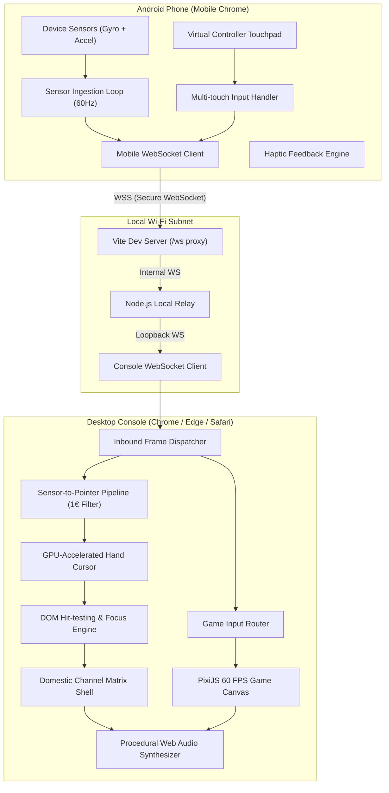

---

### (b) Network & Deployment Topology
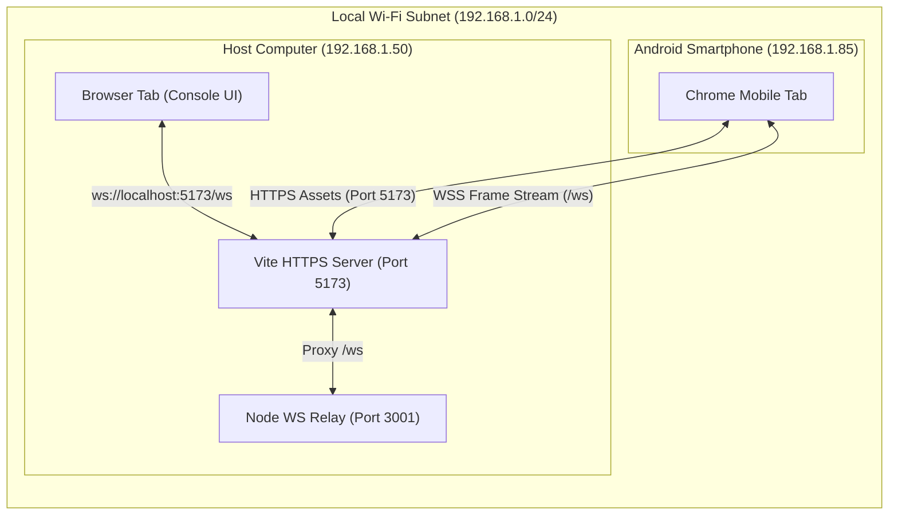

---

### (c) Pairing Sequence Diagram with QR Code
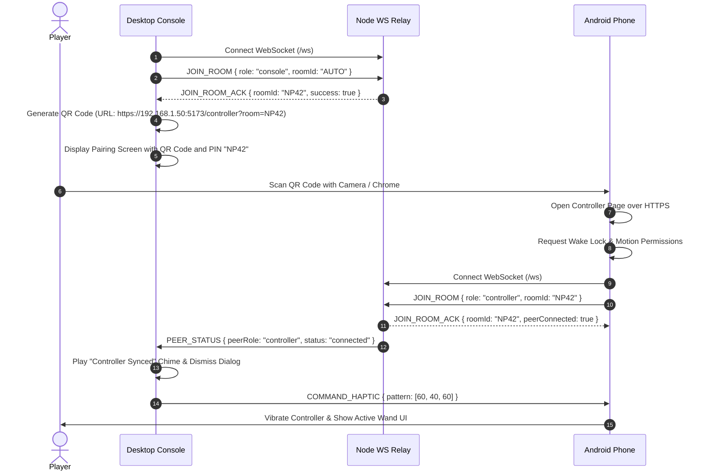

---

### (d) Per-Frame Input Sequence Diagram (Phone $\to$ Relay $\to$ Console)
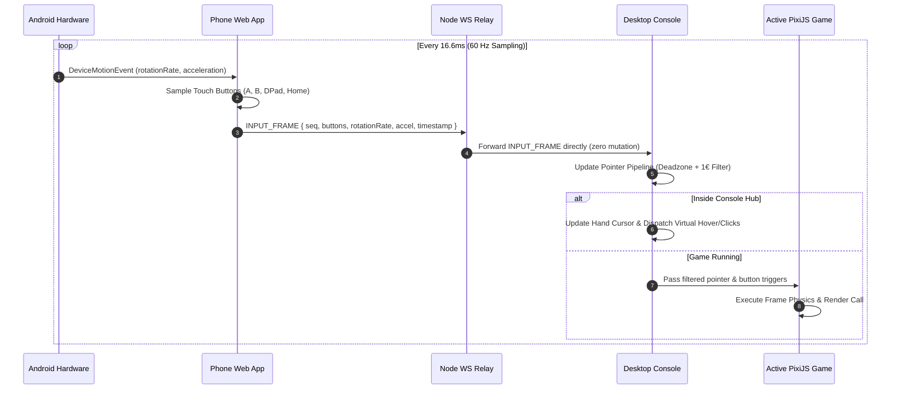

---

### (e) Controller Connection State Machine (Including Reconnect)
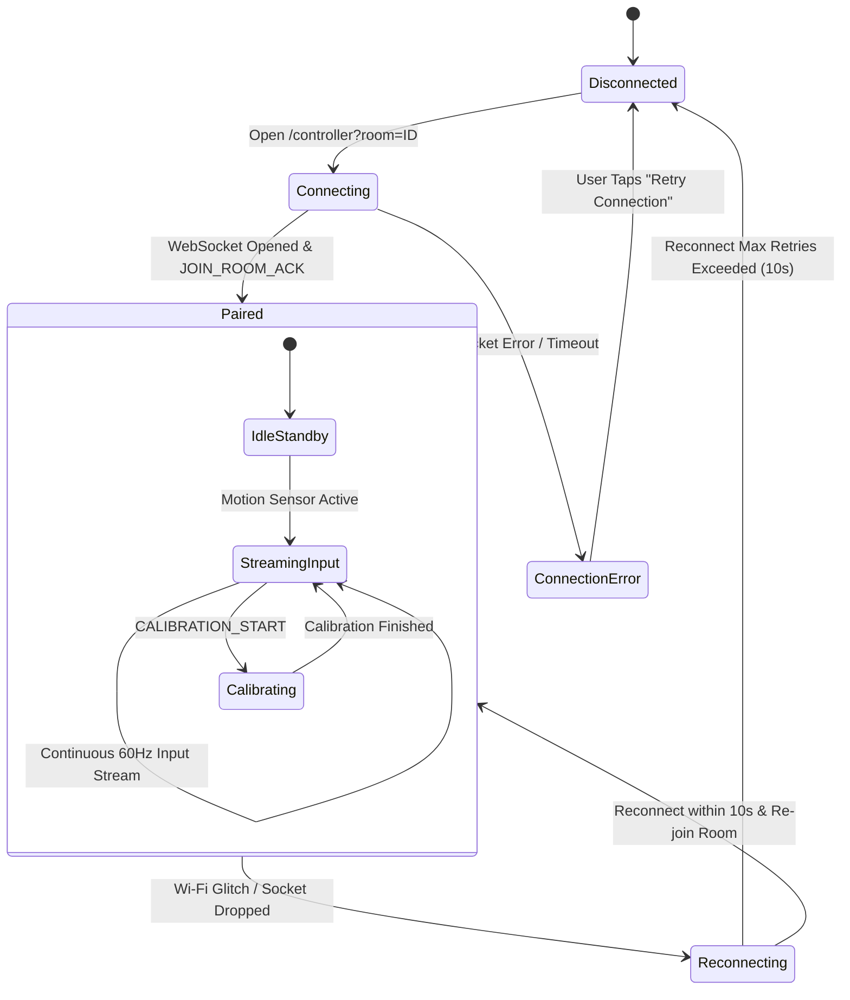

---

### (f) Sensor-to-Pointer Pipeline Flowchart
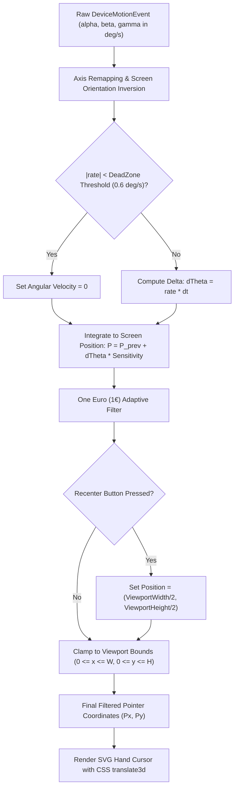

---

### (g) Calibration Flow
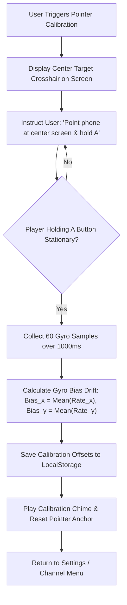

---

### (h) Remake Channel Menu Flow & 5 Game Matrix
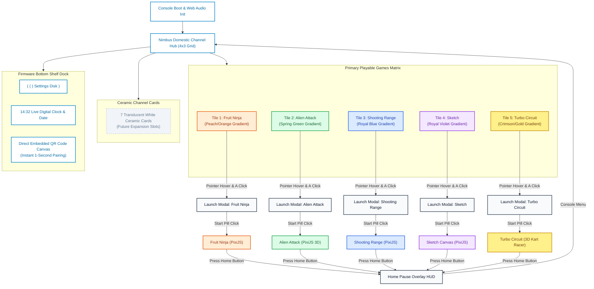

---

### (i) Controller Dynamic Input Mapping per Game
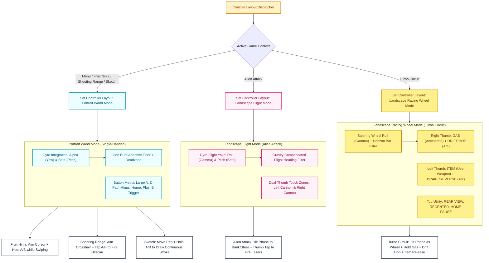

---

### (j) Game 1: Fruit Ninja Loop & State Machine
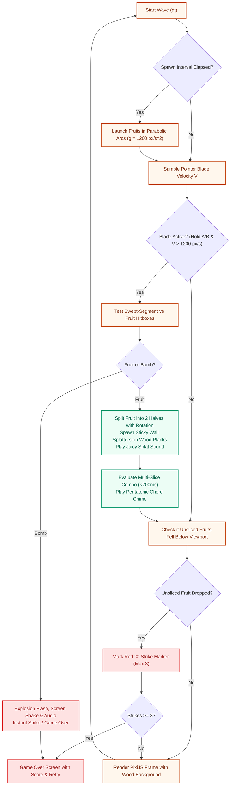

---

### (k) Game 2: Alien Attack (3D Cosmic Rail Shooter) Loop
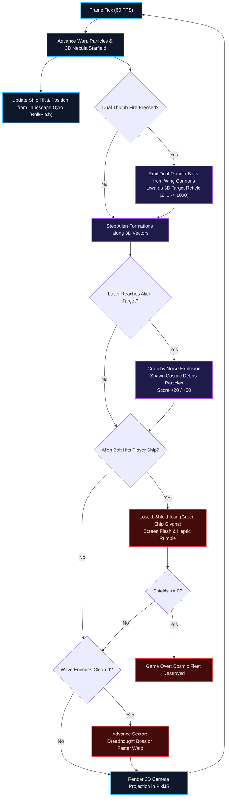

---

### (l) Game 3: Shooting Range Loop
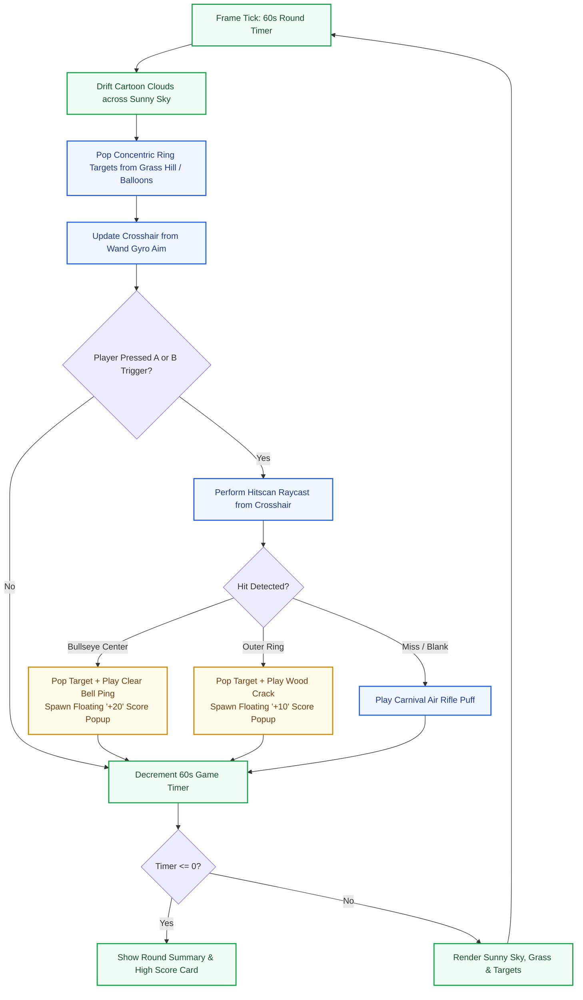

---

### (m) Game 4: Sketch Loop
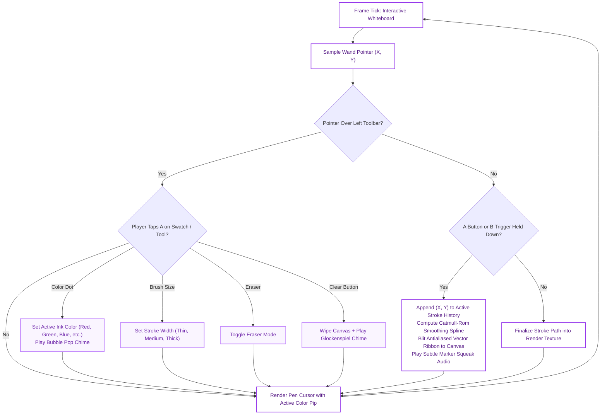

---

### (n) Game 5: Turbo Circuit Race State Machine
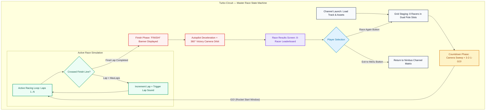

---

### (o) Game 5: Turbo Circuit Per-Frame Game Loop (60 FPS)
```mermaid
flowchart TD
    classDef inputStyle fill:#e0e7ff,stroke:#4338ca,stroke-width:2px,color:#312e81;
    classDef physStyle fill:#dcfce7,stroke:#15803d,stroke-width:2px,color:#14532d;
    classDef aiStyle fill:#fef3c7,stroke:#b45309,stroke-width:2px,color:#78350f;
    classDef itemStyle fill:#fce7f3,stroke:#be185d,stroke-width:2px,color:#831843;
    classDef camStyle fill:#ccfbf1,stroke:#0f766e,stroke-width:2px,color:#134e4a;
    classDef renderStyle fill:#f1f5f9,stroke:#334155,stroke-width:2px,color:#0f172a;

    Tick["Frame Tick (dt <= 16.6ms)"]:::inputStyle --> PollIn["1. Ingest Landscape Tilt (Roll) & Touch Buttons (Gas, Drift, Item, Brake)"]:::inputStyle
    
    subgraph PhysicsPass["2. Player Physics & State Machine"]
        PollIn --> SurfaceCheck["Sample Track Spline: Surface Type (Tarmac, Offroad, Boost, Glider)"]:::physStyle
        SurfaceCheck --> IntegratePhysics["Integrate Drive Force, Friction, Aerodynamic Drag & Gravity"]:::physStyle
        IntegratePhysics --> DriftState["Evaluate Drift State & Charge Mini-Turbo Sparks (Blue/Orange/Purple)"]:::physStyle
        DriftState --> GliderState["Evaluate Glider Aerodynamics (Lift, Pitch Dive/Climb, Bank)"]:::physStyle
    end

    subgraph AIPass["3. AI Racers Simulation (x7)"]
        GliderState --> AISplineFollow["Follow Target Waypoints with Lane Offsets"]:::aiStyle
        AISplineFollow --> AIRubberBand["Apply Rubber-Band Speed Multiplier vs Player Gap"]:::aiStyle
        AIRubberBand --> AIAvoid["Obstacle & Hazard Raycast Avoidance"]:::aiStyle
    end

    subgraph ItemCollisionPass["4. Items, Hazards & Collisions"]
        AIAvoid --> UpdateProjectiles["Step Kinetic Orbs, Dropped Slime & Ricochet Discs"]:::itemStyle
        UpdateProjectiles --> KartCollisions["Resolve Kart-to-Kart Bumpers & Kart-to-Hazard Spin-outs"]:::itemStyle
        KartCollisions --> ItemBoxPickups["Detect Item Box Roulette Triggers"]:::itemStyle
    end

    subgraph CameraRenderPass["5. Camera & Visual Presentation"]
        ItemBoxPickups --> UpdateChaseCam["Update Spring-Damped Chase Camera & Dynamic Speed FOV"]:::camStyle
        UpdateChaseCam --> RenderScene["Render 3D Track Projection, Billboards, Particles & Audio"]:::renderStyle
        RenderScene --> UpdateHUD["Update HUD: Gold Placement, Minimap, Coins & Laps"]:::renderStyle
    end

    UpdateHUD --> Tick
```

---

### (p) Game 5: Turbo Circuit Kart Physics & Drifting
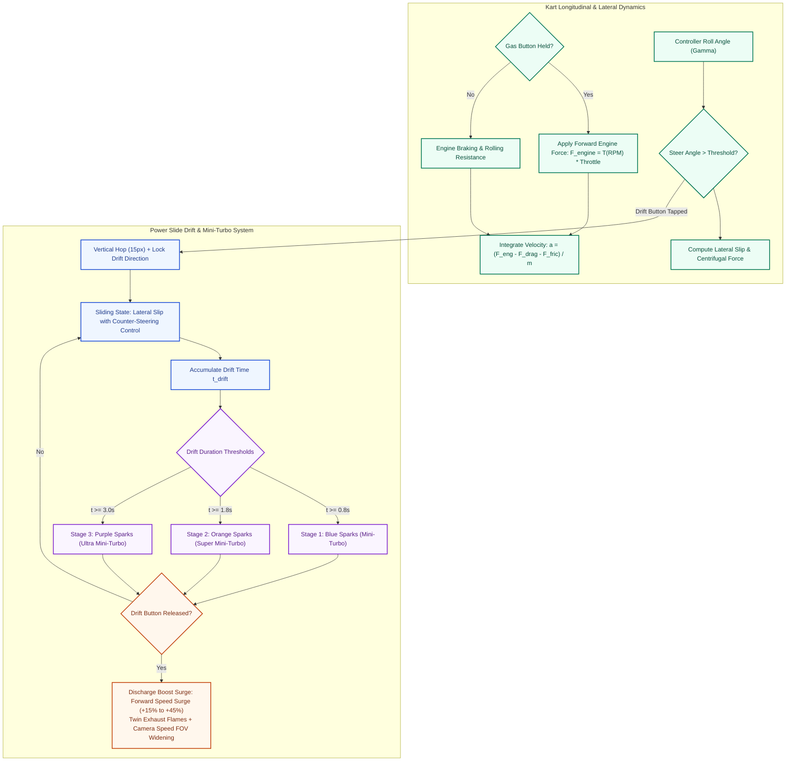

---

### (q) Game 5: Turbo Circuit AI Opponent Pathing with Rubber-Banding
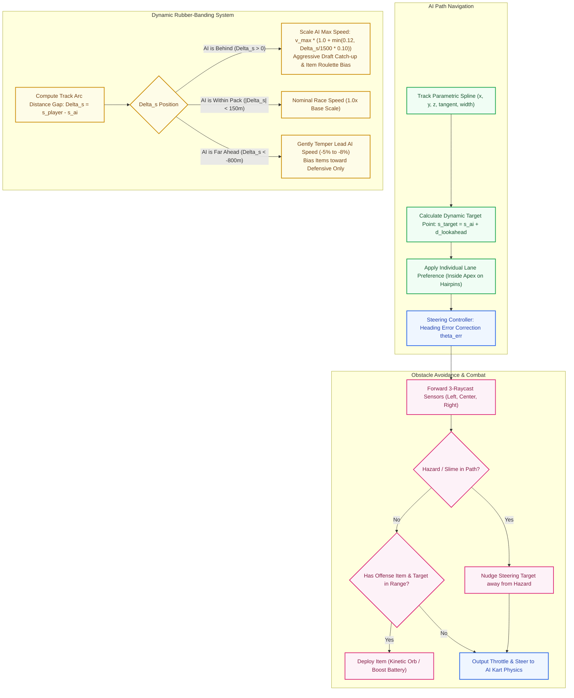

---

### (r) Game 5: Turbo Circuit Item System
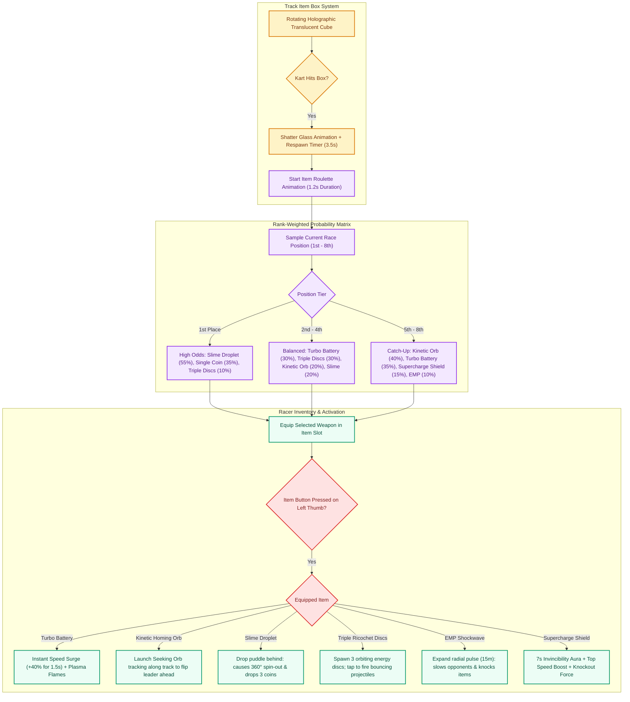

---

### (s) Game 5: Turbo Circuit Glider Ramp Section
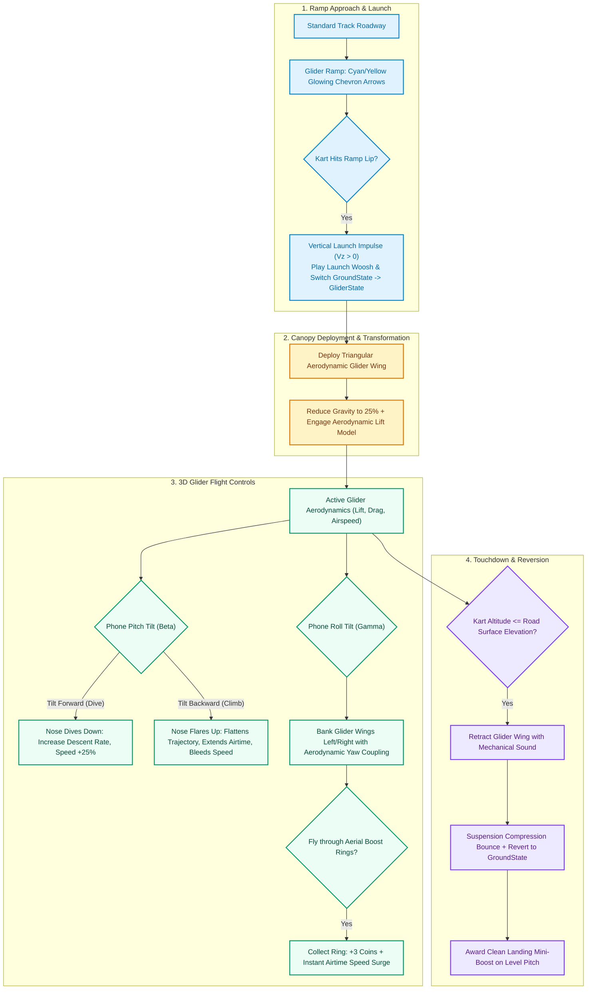

---

### (t) Game 5: Turbo Circuit Camera System
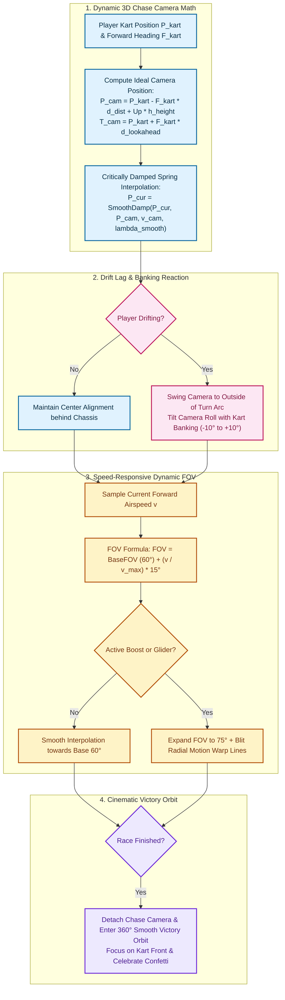

---

### (u) Game 5: Turbo Circuit Phone Landscape Controller Input Mapping
```mermaid
flowchart TD
    classDef gripStyle fill:#fef3c7,stroke:#d97706,stroke-width:2px,color:#78350f;
    classDef steerStyle fill:#ecfdf5,stroke:#059669,stroke-width:2px,color:#064e3b;
    classDef leftCluster fill:#fce7f3,stroke:#db2777,stroke-width:2px,color:#831843;
    classDef centerLeft fill:#dbeafe,stroke:#2563eb,stroke-width:2px,color:#1e40af;
    classDef centerRight fill:#e0e7ff,stroke:#6366f1,stroke-width:2px,color:#3730a3;
    classDef rightCluster fill:#fef2f2,stroke:#ef4444,stroke-width:2px,color:#991b1b;
    classDef utilStyle fill:#f1f5f9,stroke:#475569,stroke-width:2px,color:#0f172a;

    subgraph PhoneGripSection["Horizontal Two-Handed Landscape Grip (Racing Wheel)"]
        PhoneGrip["Phone held sideways in both hands like a Formula / Kart Steering Wheel"]:::gripStyle
    end

    subgraph MotionSteering["Motion Steering Pipeline (Calibrated Tilt)"]
        PhoneGrip --> CalibStep["First-Time Tilt Calibration Modal (Spirit Level Bubble)"]:::steerStyle
        CalibStep --> AccelTilt["Ingest Lateral Acceleration (a.y - zeroBias)"]:::steerStyle
        AccelTilt --> Deadzone["Deadzone Threshold: Ignore |a.y| < 0.4 m/s² (No Resting Jitter)"]:::steerStyle
        Deadzone --> Sensitivity["Linear Sensitivity Curve: Steer = clamp(sign(a.y) * (|a.y| - 0.4) * 0.28, -1, 1)"]:::steerStyle
        Sensitivity --> LiveHorizon["Live Steering Pip & Tilt Degree Readout on Top Bar"]:::steerStyle
    end

    subgraph LeftCluster["Left Thumb: D-Pad Directional Cluster"]
        PhoneGrip --> DpadLeft["D-Pad Left: Steer Hard Left (Digital Fallback)"]:::leftCluster
        PhoneGrip --> DpadRight["D-Pad Right: Steer Hard Right (Digital Fallback)"]:::leftCluster
        PhoneGrip --> DpadUp["D-Pad Up: Auxiliary Menu / Pitch Up"]:::leftCluster
        PhoneGrip --> DpadDown["D-Pad Down: Auxiliary Menu / Look Back"]:::leftCluster
    end

    subgraph CenterLeftSection["Center-Left: Primary Drive Controls"]
        PhoneGrip --> BigA["Large Circular A Button: GAS / ACCELERATE"]:::centerLeft
        PhoneGrip --> GripBar["Tall Molded Vertical Grip / Divider Bar"]:::centerLeft
    end

    subgraph CenterRightSection["Center-Right: Acoustic Matrix Graphic"]
        PhoneGrip --> SpeakerGrid["12-Dot Acoustic Speaker Grid Matrix Graphic"]:::centerRight
        PhoneGrip --> TiltHint["Subtle Tilt Guidance Legend: 'STEER ◀ ▶'"]:::centerRight
    end

    subgraph RightCluster["Right Thumb: Tactical Action Cluster"]
        PhoneGrip --> SmallB["B Button: BRAKE / REVERSE (Red / Rounded)"]:::rightCluster
        PhoneGrip --> DriftHop["Drift Button: DRIFT / HOP (Indigo / Rounded)"]:::rightCluster
        PhoneGrip --> ItemAction["Item Button: USE WEAPON (Emerald / Rounded)"]:::rightCluster
    end

    subgraph TopBarUtil["Top Utility Bar"]
        PhoneGrip --> StatusDot["Live WebSocket Connection Dot"]:::utilStyle
        PhoneGrip --> HorizonBar["Steering Balance Bar & Angle Readout (e.g. +14°)"]:::utilStyle
        PhoneGrip --> CenterBtn["CENTER: Instant Steering Re-zero Button"]:::utilStyle
        PhoneGrip --> HomePause["HOME: Pause Race & Open Console Overlay HUD"]:::utilStyle
    end
```

---

### (v) Game 5: Turbo Circuit HUD Layout Architecture
```mermaid
flowchart TD
    classDef hudBase fill:#0f172a,stroke:#38bdf8,stroke-width:2px,color:#f8fafc;
    classDef posStyle fill:#fef08a,stroke:#ca8a04,stroke-width:2px,color:#713f12;
    classDef statStyle fill:#ecfdf5,stroke:#059669,stroke-width:2px,color:#064e3b;
    classDef mapStyle fill:#e0f2fe,stroke:#0284c7,stroke-width:2px,color:#082f49;
    classDef alertStyle fill:#fee2e2,stroke:#dc2626,stroke-width:2px,color:#7f1d1d;

    subgraph HUDCanvas["Turbo Circuit — 1920x1080 Viewport HUD"]
        Viewport["Screen Viewport (16:9 Immersion Stage)"]:::hudBase
        
        subgraph BottomRightCorner["Bottom-Right: Position Display"]
            PosBadge["Massive Gold Italic Rank Badge: '8th' -> '1st'<br/>Metallic Gold Gradient (#FACC15 -> #EAB308)<br/>Drop Shadow + Ordinal Suffix + Dynamic Scale Pulse on Overtake"]:::posStyle
        end

        subgraph BottomLeftCorner["Bottom-Left: Race Telemetry"]
            CoinCard["Coin Counter: Shiny Gold Coin Glyph '🟡 x04' (Max 10)<br/>Each coin grants +1% top speed"]:::statStyle
            LapCard["Lap Counter: 'LAP 1/1' (Sprint) or 'LAP 1/3'<br/>Pulsing 'FINAL LAP!' Alert upon entering final lap"]:::statStyle
        end

        subgraph CenterRightCorner["Center-Right: Circuit Map"]
            Minimap["Track Minimap Wireframe:<br/>- Semi-transparent Circuit Vector Outline<br/>- Cyan Blip = Player 1<br/>- Orange Blips = AI Racers (x7)<br/>- Gold Crown = Current 1st Place Leader"]:::mapStyle
        end

        subgraph TopCenterSlot["Top-Center: Item Roulette Box"]
            ItemBoxSlot["Translucent Rounded Square Frame:<br/>- Spinning Roulette Reel on Pickup (1.2s)<br/>- Static Equipped Item Icon when Ready<br/>- Pulsing Glow when Usable"]:::statStyle
        end

        subgraph CenterAlerts["Center Screen Dynamic Banners"]
            CountBanner["Start Countdown: '3', '2', '1', 'GO!' (with audio tones)"]:::alertStyle
            FinishBanner["'FINISH!' Banner with Confetti on Final Lap Crossing"]:::alertStyle
            WrongWay["'WRONG WAY' Flashing Warning if driving reverse on spline"]:::alertStyle
        end

        Viewport --> BottomRightCorner
        Viewport --> BottomLeftCorner
        Viewport --> CenterRightCorner
        Viewport --> TopCenterSlot
        Viewport --> CenterAlerts
    end
```

---

### (w) Game 5: Turbo Circuit Track Data Pipeline
```mermaid
flowchart TD
    classDef defStyle fill:#e0f2fe,stroke:#0284c7,stroke-width:2px,color:#0369a1;
    classDef splineStyle fill:#fef3c7,stroke:#d97706,stroke-width:2px,color:#78350f;
    classDef genStyle fill:#ecfdf5,stroke:#059669,stroke-width:2px,color:#064e3b;
    classDef renderStyle fill:#ede9fe,stroke:#7c3aed,stroke-width:2px,color:#581c87;

    subgraph TrackDefinition["1. Raw Track Waypoint Definition"]
        NodesJSON["Track Waypoint Nodes Array (x, y, z, yaw, pitch, roll, width, surfaceType)"]:::defStyle
        Surfaces["Surface Enums: TARMAC, OFFROAD, BOOST_PAD, GLIDER_RAMP, FINISH_LINE"]:::defStyle
        NodesJSON --> Surfaces
    end

    subgraph SplineProcessing["2. Catmull-Rom 3D Spline Interpolation"]
        Surfaces --> SplineGen["Generate Smooth Continuous 3D Centerline Spline S(t)"]:::splineStyle
        SplineGen --> TangentNorm["Compute Perpendicular Track Normals & Banking Vectors"]:::splineStyle
        TangentNorm --> RoadRibbon["Extrude Left/Right Track Edges: P_left(s) = S(s) - N(s)*W/2, P_right(s) = S(s) + N(s)*W/2"]:::splineStyle
    end

    subgraph AssetPlacement["3. Trackside Entities & Collectibles"]
        RoadRibbon --> ItemNodes["Place Item Box Clusters across Track Width"]:::genStyle
        RoadRibbon --> CoinNodes["Distribute Coin Lines (Straights, Apexes, Glider Rings)"]:::genStyle
        RoadRibbon --> AIWaypoints["Generate Precomputed AI Racing Line (Optimal Apex Curve)"]:::genStyle
        RoadRibbon --> Barriers["Build Lateral Guardrail & Collision Boundaries"]:::genStyle
    end

    subgraph RuntimeEngine["4. Runtime Ingestion & Projection"]
        Barriers --> MapProjection["Project 2D Minimap Vector Outline for HUD"]:::renderStyle
        AIWaypoints --> RuntimeSim["Fast-Path Track Distance Lookup: s = Projection(Kart_pos)"]:::renderStyle
        RuntimeSim --> Render3D["Render 3D Perspective Track Segments with PixiJS"]:::renderStyle
    end
```

---

### (x) Repository Folder Tree (Remake Structure)
```mermaid
flowchart TD
    Root["NimbusPlay / (Workspace Root)"]
    
    Root --> Config["Configuration Files<br/>(package.json, tsconfig.json, vite.config.ts, tailwind.config.js)"]
    Root --> Docs["docs/<br/>- ARCHITECTURE.md<br/>- GAME_REFERENCE.md<br/>- PROGRESS.md"]
    Root --> Design["design/<br/>- DESIGN.md (Design System Tokens)<br/>- reference/ (Video-7889.mp4, Video-18621.mp4, reel-games.png, reel-menu.png)"]
    Root --> Server["server/<br/>- relay.ts (Node.js WebSocket Hub)<br/>- session.ts (Room Manager)"]
    Root --> Tests["tests/<br/>- pointer.test.ts, relay.test.ts, game-lifecycle.test.ts<br/>- alien-attack.test.ts, shooting-range.test.ts, sketch.test.ts"]
    Root --> Src["src/"]
    
    Src --> Shared["shared/<br/>- protocol.ts (TypeScript Schemas, Layout Modes & Bitmasks)"]
    Src --> Controller["controller/<br/>- index.html (Mobile Remote Entrypoint)<br/>- main.ts (60Hz Stream & Layout Mode Switcher)<br/>- sensors.ts (DeviceMotion Ingestion & Landscape Tilt)<br/>- touch.ts (Portrait Wand, Landscape Flight & Racing Wheel)"]
    Src --> Console["console/<br/>- index.html (Console Entrypoint)<br/>- main.ts (Bootstrapper, Layout Notifier & Loading)<br/>- ui/<br/>  - artwork.ts (Colored Gradient SVGs)<br/>  - catalog.ts (Remake Games Directory)<br/>  - shell.ts (4x3 Channel Matrix & Bottom QR Dock)<br/>- audio/<br/>  - audio-manager.ts (Unified Synthesizer Facade)<br/>- games/<br/>  - game-manager.ts (Session Controller)<br/>  - slice-party/ (Fruit Ninja on Cedar Planks)<br/>  - alien-attack/ (3D Cosmic Forward Rail Shooter)<br/>  - shooting-range/ (Sunny Carnival Target Shooting)<br/>  - sketch/ (Interactive Digital Whiteboard Canvas)<br/>  - turbo-circuit/ (3D Kart Racing Engine)"]
```

---

### (y) Remake Phase Roadmap Timeline
```mermaid
flowchart LR
    classDef done fill:#ecfdf5,stroke:#059669,stroke-width:2px,color:#065f46;
    classDef active fill:#eff6ff,stroke:#2563eb,stroke-width:2px,color:#1e40af;
    classDef future fill:#f8fafc,stroke:#64748b,stroke-width:2px,color:#334155;

    R0["✔ Phase R0: Reference Spec & Master Architecture"]:::done --> R1["✔ Phase R1: Menu 4-Tile Grid & Direct QR Dock"]:::done
    R1 --> R2["✔ Phase R2: Controller Landscape Flight Mode"]:::done
    R2 --> R3["✔ Phase R3: Fruit Ninja Cedar Wall & Slicing Remake"]:::done
    R3 --> R4["✔ Phase R4: Alien Attack 3D Rail Cosmic Shooter"]:::done
    R4 --> R5["✔ Phase R5: Shooting Range Carnival Targets"]:::done
    R5 --> R6["✔ Phase R6: Sketch Interactive Whiteboard"]:::done
    R6 --> R7["✔ Phase R7: System Integration, Latency & QA Sign-off"]:::done
    R7 --> R8["✔ Phase R8: 5th Game (Turbo Circuit) Architecture & Spec"]:::done
    R8 --> R9["✔ Phase R9: Turbo Circuit 3D Kart Racer Implementation"]:::done
    R9 --> R10["✔ Phase R10: Turbo Circuit Championship & AI Opponents"]:::done
    R10 --> R11["✔ Phase R11: Landscape Racing Controller & Steering Tilt"]:::done
```

---

### (z) Error Handling & Troubleshooting Decision Tree
```mermaid
flowchart TD
    ErrorDetect["Issue Observed during Setup / Play"] --> CheckType{"What symptom is occurring?"}
    
    CheckType -- "Phone can't connect to Laptop URL" --> CheckSameSubnet{"Are Phone and Laptop on identical Wi-Fi?"}
    CheckSameSubnet -- No --> JoinSame["Connect both devices to the same Wi-Fi network"]
    CheckSameSubnet -- Yes --> CheckAPIsolation{"Does Wi-Fi enforce Client / AP Isolation?"}
    CheckAPIsolation -- Yes --> UseHotspot["Enable Mobile Hotspot on Phone or Laptop<br/>and connect the other device directly"]
    CheckAPIsolation -- No --> CheckFirewall["Check Laptop Firewall: Allow inbound on port 5173"]
    
    CheckType -- "Browser SSL / HTTPS Certificate Warning" --> SelfSignedCert["Expected: basic-ssl uses a self-signed cert.<br/>In Chrome: Tap 'Advanced' -> 'Proceed to unsafe'"]
    
    CheckType -- "No Pointer Movement on Screen" --> CheckPerms{"Did Phone grant Motion Permissions?"}
    CheckPerms -- No --> ToggleSensors["In Chrome Android: Settings -> Site Settings -> Motion Sensors -> Allow"]
    CheckPerms -- Yes --> CheckFlag["Check chrome://flags/#enable-generic-sensor-extra-classes"]
    
    CheckType -- "Pointer Drifting Constantly" --> RestPhone["Place phone on flat surface and trigger 'Calibrate' in Settings"]
    
    CheckType -- "Phone Screen Turns Off" --> VisibilityRecovery["Touch wake resets touch bitmask and re-acquires Wake Lock"]
    
    CheckType -- "Laggy or Stuttering Pointer" --> CheckNetworkLatency["Check ping in Debug HUD [D]: Target <30ms.<br/>Switch to 5GHz Wi-Fi or Personal Hotspot"]
```

---

## 4. WebSocket Message Protocol Specification

All frames exchange structured JSON packets with a unified schema over the `/ws` route.

| Message Type | Direction | Target Frequency | Required Fields | Description |
| :--- | :--- | :--- | :--- | :--- |
| `JOIN_ROOM` | Client $\to$ Relay | On connection | `role` ('console' \| 'controller'), `roomId` (string) | Registers client in specified room session. |
| `JOIN_ROOM_ACK` | Relay $\to$ Client | Response to Join | `success` (bool), `roomId` (string), `peerConnected` (bool) | Confirms room admission and peer presence status. |
| `PEER_STATUS` | Relay $\to$ Client | On state change | `peerRole` (string), `status` ('connected' \| 'disconnected') | Notifies peer of connect/disconnect events. |
| `INPUT_FRAME` | Controller $\to$ Console | 60 Hz ($\approx 16.6\text{ms}$) | `buttons` (object), `rotationRate` (object), `accel` (object), `timestamp` | High-frequency sensor & touch frame. |
| `COMMAND_RECENTER` | Controller $\to$ Console | On demand (Home/Btn) | `timestamp` | Re-anchors cursor to screen viewport midpoint. |
| `COMMAND_HAPTIC` | Console $\to$ Controller | Event-triggered | `pattern` (number array in ms) | Triggers device vibration (e.g. on click/slice). |
| `CALIBRATION_START`| Console $\to$ Controller | On user request | `timestamp` | Enters high-precision bias drift sampling mode. |
| `CALIBRATION_OFFSET`| Controller $\to$ Console| Post-calibration | `offsetBeta` (float), `offsetGamma` (float) | Sends computed resting gyro bias to console. |
| `PING` / `PONG` | Both directions | Every 3000 ms | `timestamp` | Calculates real-time round-trip latency (RTT). |

---

## 5. Performance Budget & Latency Engineering

To deliver an authentic console experience, NimbusPlay operates under a strict budget:

| Pipeline Stage | Target Latency Budget | Implementation Strategy |
| :--- | :--- | :--- |
| **Sensor Hardware Sampling** | $\le 16.6\text{ ms}$ (60Hz) | `DeviceMotionEvent` in Chrome Android runs at display refresh rate. |
| **Phone JSON Serialization** | $\le 1.0\text{ ms}$ | Pre-allocated flat payload object; no deep object cloning. |
| **Wi-Fi Transport (Phone $\to$ Relay)** | $\le 5.0\text{ ms}$ | Local LAN WebSocket framing; minimal TCP buffer bloat. |
| **Node Relay Forwarding** | $\le 1.0\text{ ms}$ | Zero parsing/mutation: in-memory socket forwarding. |
| **Console Filtering & 1€ Math** | $\le 0.5\text{ ms}$ | Direct numeric arithmetic; zero memory allocations per tick. |
| **DOM / PixiJS GPU Render Pass**| $\le 5.0\text{ ms}$ | Hardware-accelerated CSS 3D transforms & WebGL batched rendering. |
| **Total End-to-End Latency** | **$< 30.0\text{ ms}$** | **Completely imperceptible lag on standard 60Hz displays.** |

---

## 6. Design Tokens & Visual Fidelity

The visual presentation adheres to the specifications in [`design/DESIGN.md`](file:///Users/adityasurse/Documents/NimbusPlay/design/DESIGN.md):
- **Primary Electric Cyan (`#3CB4E7`)**: Active channel focus outlines, primary pill fills, pointer indicator pips.
- **Deep Oceanic Cyan (`#1B8FCB`)**: Active click/press states, high-emphasis icons.
- **Pale Wave Background (`#D6E6F2`)**: Animated background sinusoidal wave overlays.
- **Ceramic White Surfaces (`#FFFFFF`)**: Injection-molded channel card tiles with 1px borders (`#CFD8E0`) and inner specular top highlights (`inset 0 2px 0 0 #FFF`).
- **Typography**: Clean, friendly `Nunito Sans` paired with mid-2000s expanded tracking (`0.08em` to `0.12em`) on utility badges and clocks.

---

## 7. How to Run on Android over HTTPS

1. **Start the Development Server & Relay Hub**:
   ```bash
   npm run dev
   ```
   Both Vite's HTTPS development server (port `5173`) and the Node.js WebSocket relay (internal port `3001`) bootstrap concurrently in $< 200$ ms.

2. **Retrieve Local Host IP Address**:
   The terminal outputs your local LAN URL, for example:
   ```
   > LAN Network: https://192.168.1.50:5173
   ```

3. **Open the Console on your Desktop Computer**:
   Visit `https://localhost:5173` in Chrome, Edge, or Safari on your laptop. Click or press any key on the first visit to initialize the Web Audio engine and launch the interactive Onboarding Guide.

4. **Pair the Nimbus Wand (Mobile Controller)**:
   - On your Android smartphone, open Google Chrome and navigate to the pairing URL (or scan the on-screen QR code shown on the console Pairing screen or reconnect modal):
     `https://<YOUR-LAPTOP-IP>:5173/controller?room=<code>`
   - Tap **Enable motion** to initialize sensor ingestion, acquire the Screen Wake Lock, and enter full-screen mode.
   - Point your phone at the screen to pilot the on-screen hand pointer!

---

## 8. Comprehensive Android Troubleshooting Guide

Connecting modern mobile browsers to a local desktop server over secure WebSockets involves device sensor policies, SSL security, and network topology rules. Follow these proven steps if you encounter any friction:

### 8.1 Self-Signed SSL Certificate Warning
- **Symptom**: Android Chrome displays *"Your connection is not private"* (`NET::ERR_CERT_AUTHORITY_INVALID`) when opening the controller URL.
- **Why this occurs**: Android Chrome strictly forbids `DeviceMotionEvent`, `DeviceOrientationEvent`, and the Generic Sensor API on insecure HTTP origins (`http://`). Vite uses `@vitejs/plugin-basic-ssl` to generate a lightweight, self-signed local certificate for development.
- **Resolution**:
  1. On the Chrome warning screen, tap **Advanced** (at the bottom).
  2. Tap **Proceed to <your-ip> (unsafe)**.
  3. The page will load securely over HTTPS and unlock motion sensor hardware immediately.

### 8.2 Motion Sensor Hardware & Permissions
- **Symptom**: The controller connects, but the cursor does not move or the console debug overlay displays `0.00` across all gyro and accelerometer axes.
- **Resolution**:
  1. **Site Settings Check**: In Chrome Android, tap the **lock / tune icon** in the URL address bar $\to$ tap **Site settings** $\to$ ensure **Motion sensors** is set to **Allowed**.
  2. **Android Chrome Sensor Flags**: Some Android builds (especially MIUI, ColorOS, or custom ROMs) disable sensor access for background tabs or require explicit generic sensor flags. Navigate to `chrome://flags` in Chrome Android, search for `#enable-generic-sensor-extra-classes`, set it to **Enabled**, and tap **Relaunch**.
  3. **Sensor Watchdog**: If the mobile controller detects flat zero sensor values for more than 2 seconds after activation, it displays a yellow warning badge *"Sensor data flat - check permissions"*. Tap the badge to re-trigger permissions.

### 8.3 Local Firewall & Port Binding (macOS / Windows / Linux)
- **Symptom**: Chrome Android shows `ERR_CONNECTION_TIMED_OUT` or `ERR_ADDRESS_UNREACHABLE` when navigating to `https://<laptop-ip>:5173`.
- **Why this occurs**: Desktop operating system firewalls frequently block incoming LAN traffic on non-standard ports like `5173`.
- **Resolution**:
  - **macOS**: Open **System Settings** $\to$ **Network** $\to$ **Firewall**. Click **Options...** and ensure either the firewall is temporarily disabled for local testing or `node` / `vite` is set to *"Allow incoming connections"*.
  - **Windows**: Open **Windows Defender Firewall** $\to$ tap **Allow an app or feature through Windows Defender Firewall** $\to$ ensure Node.js is allowed on **Private** networks. Alternatively, in PowerShell (Admin):
    ```powershell
    New-NetFirewallRule -DisplayName "NimbusPlay Vite" -Direction Inbound -LocalPort 5173 -Protocol TCP -Action Allow
    ```
  - **Linux (ufw)**:
    ```bash
    sudo ufw allow 5173/tcp
    ```

### 8.4 Wi-Fi Client Isolation (AP Isolation) & Mobile Hotspot
- **Symptom**: Laptop and phone are connected to the same Wi-Fi router, but the phone cannot ping or connect to the laptop IP.
- **Why this occurs**: University, corporate, hotel, and public Wi-Fi networks (and some guest Wi-Fi home networks) enforce **Client Isolation** (AP Isolation), which actively drops peer-to-peer packets between wireless devices on the same subnet.
- **Resolution**:
  1. **Personal Mobile Hotspot (Recommended)**: Turn on **Portable Wi-Fi Hotspot** on your Android phone and connect your laptop to the phone's hotspot. Both devices will share an isolated, ultra-low-latency LAN subnet with zero firewall blocks and zero packet drops.
  2. **Home Router Setting**: In your home router admin panel (`192.168.1.1`), navigate to Wireless Settings and uncheck **"AP Isolation"** or **"Client Isolation"**.

### 8.5 Screen Sleep, Inactivity & Screen Wake Lock
- **Symptom**: Player sets the phone down or the phone screen turns off, causing the cursor to freeze.
- **Resolution**:
  - NimbusPlay automatically engages the **Screen Wake Lock API** (`navigator.wakeLock.request('screen')`) when tapping "Enable motion".
  - **Visibility Change Recovery**: If the phone is locked or switched to another app, the `visibilitychange` listener immediately resets all active touch states, transmits a clean button bitmask (`0`), and pauses the 60Hz sensor interval. When the screen turns back on, the wake lock is re-acquired, sensors restart automatically, and a toast *"Wand active & wake lock restored"* confirms readiness.

---

## 9. Visual System Gallery & Reference Target Alignment

NimbusPlay faithfully recreates the authentic 4-game reference demonstrated in `/design/reference/Video-7889.mp4`, `reel-games.png`, and `reel-menu.png`.

### 9.1 Console Domestic Channel Matrix (Top 4 Colored Tiles + Direct Bottom QR)
```
+---------------------------------------------------------------------------------------+
|  [P1] WAND CONNECTED                              14:32  WED 04 NOV     [=] AMBIENCE  |
+---------------------------------------------------------------------------------------+
|                                                                                       |
|   +---------------+   +---------------+   +---------------+   +---------------+       |
|   |  FRUIT NINJA  |   | ALIEN ATTACK  |   | SHOOTING RANGE|   |    SKETCH     |       |
|   | [Peach Gradient]  | [Green Grad.] |   | [Blue Grad.]  |   | [Purple Grad.]|       |
|   |  (Watermelon) |   | (Retro Alien) |   | (Bullseye)    |   |  (Palette)    |       |
|   +---------------+   +---------------+   +---------------+   +---------------+       |
|                                                                                       |
|   +---------------+   +---------------+   +---------------+   +---------------+       |
|   |  EMPTY CARD   |   |  EMPTY CARD   |   |  EMPTY CARD   |   |  EMPTY CARD   |       |
|   | [Frosted Glass]   | [Frosted Glass]   | [Frosted Glass]   | [Frosted Glass]       |
|   +---------------+   +---------------+   +---------------+   +---------------+       |
|                                                                                       |
|   +---------------+   +---------------+   +---------------+   +---------------+       |
|   |  EMPTY CARD   |   |  EMPTY CARD   |   |  EMPTY CARD   |   |  EMPTY CARD   |       |
|   | [Frosted Glass]   | [Frosted Glass]   | [Frosted Glass]   | [Frosted Glass]       |
|   +---------------+   +---------------+   +---------------+   +---------------+       |
|                                                                                       |
+---------------------------------------------------------------------------------------+
|     ( ( ) SETTINGS )             14:32  TUE 04 NOV          [ QR CODE FOR PAIRING ]   |
+---------------------------------------------------------------------------------------+
```

### 9.2 Nimbus Wand Controller (Dual Orientation Modes)

```
[ PORTRAIT WAND MODE ]                            [ LANDSCAPE FLIGHT MODE (ALIEN ATTACK) ]
(Fruit Ninja, Shooting Range, Sketch)             +---------------------------------------------------+
+-----------------------------------+             | [P1] 10ms   [LEFT CANNON]      [RIGHT CANNON]     |
| [P1 CONNECTED]  10ms RTT  [||| 95%]|             |             ( FIRE LASER )     ( FIRE LASER )     |
|                                   |             |                                                   |
|               ( A )               |             |  [ ROLL LEFT / RIGHT ]      [ PITCH UP / DOWN ]   |
|         Primary Trigger / Draw    |             |   Tilt phone to bank ship    Tilt phone to aim    |
|                                   |             |                                                   |
|                 ^                 |             |              ( - )     [HOME]     ( + )           |
|             <  DPAD  >            |             +---------------------------------------------------+
|                 v                 |
|                                   |
|       (-)       (H)       (+)     |
|      Minus      Home      Plus    |
|                                   |
|             [RECENTER]            |
|                                   |
|   +---------------------------+   |
|   |      [B TRIGGER]          |   |
|   +---------------------------+   |
+-----------------------------------+
```

### 9.3 Game 1: Fruit Ninja (Cedar Planks & Juice Splatters)
```
+---------------------------------------------------------------------------------------+
|  (WATERMELON) 49                                                        STRIKES: X X X|
|  BEST: 49                                                                             |
|                                                                                       |
|                \   (WATERMELON)  /                                                    |
|                 \   [Splash!!]  /                                                     |
|                  \             /                                                      |
|                   \  ~*~*~*~*~*~*~ [Luminous Cyan Energy Blade Ribbon]                |
|                    \                                                                  |
|                     * (Apple Half)  --> +1                                            |
|                                                                                       |
|           * * * [ Sticky Yellow & Red Juice Splatters on Cedar Planks ] * * *         |
|                     [ Vertical Timber Woodgrain Background ]                          |
+---------------------------------------------------------------------------------------+
```

### 9.4 Game 2: Alien Attack (3D Forward Cosmic Rail Shooter)
```
+---------------------------------------------------------------------------------------+
|  SCORE: 640                                                  SHIELDS: [🚀] [🚀] [🚀]   |
|                                                                                       |
|                          ( Saturn-like Ringed Gas Giant )                             |
|                                    O=-(====)-=O                                       |
|                                                                                       |
|                             (O) 3D Target Portal Ring                                 |
|                            /   \                                                      |
|                          (v)   (v)  [Alien Saucers flying forward]                    |
|                                                                                       |
|                           ==|| Dual Wing Plasma Bolts ||==                            |
|                                                                                       |
|                       [/\ White & Red Starship Fuselage /\]                           |
|                         [ Blue Glowing Jet Thruster Plumes ]                          |
|              [ Deep Indigo Cosmic Void with Violet Glowing Nebulae ]                  |
+---------------------------------------------------------------------------------------+
```

### 9.5 Game 3: Shooting Range (Sunny Carnival Target Range)
```
+---------------------------------------------------------------------------------------+
|  [ SCORE: 355 ]                                                  TIME REMAINING: 42s  |
|                                                                                       |
|             (Puffy Drifting Cloud)                   (O) Concentric Red Bullseye      |
|                                                                                       |
|        (O) Orange Bullseye                                                            |
|          Pop-up target                                                                |
|                                    (+) Crosshair                                      |
|                                     |                                                 |
|                                    +20 [Floating Hit Score]                           |
|                                                                                       |
|  _.~"~._.~"~._.~"~._.~"~._.~"~._.~"~._.~"~._.~"~._.~"~._.~"~._.~"~._.~"~._.~"~._.~"~. |
|               [ Rolling Green Grass Hill & Cute Cartoon Trees ]                       |
|               [ Vibrant Cyan Daytime Sky with Parallax Drift ]                        |
+---------------------------------------------------------------------------------------+
```

### 9.6 Game 4: Sketch (Interactive Whiteboard Canvas)
```
+---------------------------------------------------------------------------------------+
| [PALETTE]                                                                             |
|  (Red)                                                                                |
|  (Orange)        * * * * * * * * * * * * * * * * * * * * * * * * * * * *              |
|  (Yellow)        *                                                     *              |
|  (Green)         *     I    (HEART)    V I B E C O D I N G             *              |
|  (Cyan)          *                                                     *              |
|  (Navy)          *                   : )   ~ ~                         *              |
|  (Purple)        *                                                     *              |
|  (Black)         * * * * * * * * * * * * * * * * * * * * * * * * * * * *              |
|                                                                                       |
| [TOOLS]                                                                               |
|  (o) Small                                                                            |
|  (O) Med           [ Smooth Anti-Aliased Catmull-Rom Vector Strokes ]                 |
|  (0) Large         [ Continuous Ink with Wand Button A Held Down ]                    |
|  [Eraser]                                                                             |
|  [Clear]                                                                              |
+---------------------------------------------------------------------------------------+
```

### 9.7 Game 5: Turbo Circuit (3D Kart Racer with Glider Ramps)
```
+---------------------------------------------------------------------------------------+
|                               [ ( ? ) ITEM ROULETTE ]                                 |
|                                                                                       |
|                 \            /                                                        |
|                  \   /\     /        [ Glider Ramp Ahead: Glowing Chevrons ]          |
|                   \ /  \   /         [ Aerial Boost Rings in Sky ]                    |
|                    | == |                                                             |
|                    | == |                                          /| (Minimap)       |
|                  /--------\                                       / |                 |
|                 /  P1 KART \                                     |  | [*] Racers      |
|               (O) (VOLT) (O)                                      \ |                 |
|               [Blue Drift Sparks]                                  \|                 |
|                                                                                       |
|  🟡 x04 (Coins)                                                      // 8th //        |
|  LAP 1/1                                                           [GOLD ITALIC]      |
+---------------------------------------------------------------------------------------+
```

---

## 10. Verification & Testing Checklist (Remake Target)

- [x] **Network Connectivity**: Phone and laptop establish WebSocket connection on same subnet in $< 200$ ms.
- [x] **Sensor Feed**: Continuous stream of compact 60Hz packets with orientation payload.
- [x] **Filter Smoothing**: Pointer is rock-steady when hand is resting; immediate $< 1$ frame response on rapid swings via One Euro filter.
- [x] **Channel Menu Remake**: 4x3 grid with top row featuring exactly 4 colored gradient game tiles (Fruit Ninja, Alien Attack, Shooting Range, Sketch) and direct bottom-right QR code.
- [x] **Dynamic Layout Switching**: Controller switches seamlessly between Portrait Wand Mode and Landscape Flight Mode.
- [x] **Game 1 (Fruit Ninja)**: Slicing fruits on vertical cedar wall; watermelon score HUD; `X X X` strike markers; sticky wall splatters.
- [x] **Game 2 (Alien Attack)**: 3D forward rail shooter; two-handed landscape phone tilt steering; dual plasma cannons; Saturn ringed planet; 3 shield icons.
- [x] **Game 3 (Shooting Range)**: Carnival sunny sky and rolling green grass; animated concentric bullseye targets; hitscan crosshair aiming; floating score text.
- [x] **Game 4 (Sketch)**: Interactive white canvas; vertical color palette; brush size selectors; continuous vector pen drawing with A held.
- [x] **Web Audio Procedural Engine**: UI chirps, blade slashes, juicy splats, laser blasters, carnival rifle pops, bullseye bells, marker squeaks.
- [x] **Performance & Latency**: Input-to-cursor latency $< 30$ ms verified in live debug overlay (**`D`** key).
- [x] **Automated Test Suite**: 60 unit tests across 18 suites passing cleanly with 0 failures (`npm test`).
- [x] **Strict TypeScript & Build**: Zero `any` types, strict compilation passing, production Vite build succeeding cleanly.

---

## 11. Risk List & Mitigation Strategies

| Risk | Impact | Mitigation Strategy |
| :--- | :--- | :--- |
| **Gyroscope Drift** | Pointer slowly drifts away from physical pointing angle over time. | 1. Deadzone thresholding cutoffs.<br/>2. One-touch Recenter button on Home button.<br/>3. Resting bias calibration routine in settings. |
| **Landscape Tilt Inversion** | Screen rotation in landscape mode could invert pitch/roll axes. | Gyroscope axis re-mapping based on explicit `mode: 'landscape'` orientation flag in sensor ingestion. |
| **Android Chrome Throttling** | Chrome reduces timer resolution when battery is low or tab is backgrounded. | 1. Screen Wake Lock API prevents sleep.<br/>2. Passive sensor event listeners avoid main-thread throttling.<br/>3. Fullscreen mode ensures maximum foreground priority. |
| **Self-Signed SSL Warning** | Users unfamiliar with development certificates might get stuck. | Clear visual instructions on pairing screen explaining how to tap "Advanced → Proceed". |
| **AP Isolation on Public Wi-Fi** | Devices on same campus/hotel network cannot route to each other. | Built-in troubleshooting guide recommending Android personal hotspot tethering. |

---

## 12. Remake Phase Execution Checklist

- [x] **Phase R0: Reference Analysis & Master Specification**
  - [x] Inspect `/design/reference/Video-7889.mp4`, `reel-games.png`, and `reel-menu.png`.
  - [x] Author comprehensive `docs/GAME_REFERENCE.md` detailing all 4 games and comparison matrix.
  - [x] Update `docs/ARCHITECTURE.md` and `README.md` with colorful Mermaid diagrams and updated roadmap.
  - [x] Deprecate Star Defender and Bowl Blitz from the active plan.
- [x] **Phase R1: Channel Matrix Remake & Direct QR Dock**
  - [x] Reconfigure 4×3 Channel Grid so top row houses 4 colored gradient tiles (Fruit Ninja, Alien Attack, Shooting Range, Sketch).
  - [x] Render 8 frosted glass empty channel cards for lower rows.
  - [x] Embed live pairing QR code canvas directly into the bottom-right shelf dock.
  - [x] Hand pointer displays cyan Player 1 badge with white "1".
  - [x] Remove legacy Star Defender and Bowl Blitz channels and code.
- [x] **Phase R2: Controller Landscape Flight Mode & Layout Switcher**
  - [x] Implement `COMMAND_LAYOUT_MODE` protocol message (`mode: 'portrait' | 'landscape'`).
  - [x] Build two-handed horizontal landscape flight yoke UI for Alien Attack with dual-thumb triggers.
  - [x] Implement tilt flight steering filter with horizon bar feedback.
- [x] **Phase R3: Game 1 — Fruit Ninja Remake**
  - [x] Authentic vertical timber cedar wood plank backdrop with dark recessed seams.
  - [x] Watermelon score icon with `BEST` subtitle and 3 bold red `X X X` strike markers.
  - [x] Persistent sticky juice splatters on wooden planks.
  - [x] 5 reference fruits (watermelon, orange, lemon, strawberry, apple) + original bombs.
  - [x] Holding A button to slice with glowing blade trail.
  - [x] Missing intact fruit costs a strike; bombs end game immediately.
- [x] **Phase R4: Game 2 — Alien Attack (3D Cosmic Rail Shooter)**
  - [x] Deep royal-blue cosmic space backdrop with soft glowing purple, pink, and cyan nebula blobs.
  - [x] Ringed orange planet drifting in the background and downward-streaking white warp speed lines.
  - [x] Player starship with white fuselage, red delta wings, animated blue thruster exhaust dots, and banking roll tilt.
  - [x] Landscape phone tilt steering & dual firing buttons; descending asteroids, saucers, and alien in glowing ring bubble.
  - [x] Top-left score & BEST; top-right 3 green hearts for hull lives and shield active indicator; power-up capsules.
- [x] **Phase R5: Game 3 — Shooting Range (Carnival Target Pop)**
  - [x] Bright blue cartoon sky with drifting fluffy cumulus clouds and warm sun glare.
  - [x] Layered rolling green grass meadow with rounded cartoon trees on the left and right flanks.
  - [x] Pop-up and floating concentric bullseye targets (red & white, gold-ringed, black-ringed).
  - [x] Gyro pointer precision crosshair with animated recoil kick and hitscan line-of-sight testing.
  - [x] Proximity scoring (+25 dead center bullseye, +15 inner, +10 outer) and floating "+N" popups.
  - [x] 60-second round countdown timer with accuracy stats and Round Over modal.
- [x] **Phase R6: Game 4 — Sketch (Interactive Whiteboard Canvas)**
  - [x] Clean studio white canvas surface filling the entire viewport.
  - [x] Thin left vertical frosted palette with 10 color swatches and active selection ring.
  - [x] 3 brush size selector dots (Thin, Medium, Thick), Eraser mode, Undo, and Clear.
  - [x] Gyro pointer freehand drawing holding A with quadratic curve smoothing and round caps.
  - [x] Preloaded reference marker drawing: "I ❤️ VIBECODING".
- [x] **Phase R7: Final Polish, Latency Profiling & QA Sign-off**
  - [x] End-to-end integration testing across all 4 games.
  - [x] Input-to-cursor latency verification ($< 30$ ms).
  - [x] Pause overlay with Home button (Resume, Back to Menu) and continuous controller connection.
  - [x] Update `docs/PROGRESS.md` with final sign-off.
- [x] **Phase R8: 5th Game (Turbo Circuit) Architecture & Specification**
  - [x] Inspect `/design/reference/Video-18621.mp4` reference: chase camera, 3-2-1-GO, 8 racers, gold italic position, coins/laps, minimap, glider ramp, finish banner, results screen.
  - [x] Author comprehensive 3D kart racer specification in `docs/GAME_REFERENCE.md`.
  - [x] Author 10 colorful Mermaid flowcharts across `README.md` and `docs/ARCHITECTURE.md`.
  - [x] Specify 100% original roster, karts, tracks, items, and Web Audio FM synthesis.
- [x] **Phase R9: Turbo Circuit 3D Kart Racer Implementation (Three.js Engine)**
  - [x] Glossy channel tile with red-to-teal gradient, original kart SVG icon, and white label.
  - [x] Closed procedural 3D racetrack from CatmullRom spline with asphalt road, lane markings, blue/white curbs, and grass infield.
  - [x] Stadium environment with 5-tier grandstands, procedural crowd, 4 steel floodlight towers, start/finish gantry, and sponsor barriers.
  - [x] Low-poly original kart and driver ("Volt") with spinning wheels, front steering pivot, and driver turn lean.
  - [x] Arcade kart physics: acceleration, braking, speed-dependent steering damping, off-road grass slowdown, and barrier wall bounce.
  - [x] Smooth dynamic chase camera with corner banking tilt and FOV kick ($60^\circ \to 75^\circ$) when boosting.
  - [x] Daylight stadium sky, directional sun with soft shadows, and distance fog.
  - [x] Full HUD overlay: gold italic position badge, digital speedometer, coin counter, lap counter, and minimap track outline.
  - [x] Dual-input support: phone landscape tilt steering + buttons, and desktop WASD/Arrow keyboard fallback.
  - [x] 100% test pass rate (70/70 tests) and 0-error strict TypeScript build.
- [x] **Phase R10: Turbo Circuit Full Race Championship & AI Opponents**
  - [x] 3-2-1-GO center countdown with audio bleeps and rocket start window.
  - [x] 8 racers on staggered starting grid (player starts 8th at the back).
  - [x] 7 AI opponents (Nova, Blaze, Pixel, Echo, Rex, Luna, Apex) with spline navigation, lane offsets, rubber-banding, and bumping.
  - [x] Checkpoint lap system (3 laps) with `FINAL LAP!` alert.
  - [x] Live position ranking dynamically calculated and animated on HUD.
  - [x] 3-tier drift mini-turbo sparks (Blue, Orange, Purple) with boost on release.
  - [x] Item boxes awarding original items: Turbo Boost, Rocket Orb, Oil Slick, and Shield.
  - [x] Collectible coins increasing top speed; drop 3 coins on spin-out.
  - [x] Glider ramp section with deployable delta wing and aerial flight physics.
  - [x] HUD matching reference: gold italic position pop, coin/lap counters, minimap dots, and top-left item roulette.
  - [x] "FINISH!" banner and Race Results screen with "Race Again" and "Back to Menu" buttons.
  - [x] Web Audio synthesized engine, drift, boost, item, and finish sounds; controller vibration on boosts, bumps, and hits.
- [x] **Phase R11: Turbo Circuit Landscape Controller & Steering Wheel Tilt**
  - [x] Mobile landscape controller layout tailored for Turbo Circuit (`/controller` with `mode: 'landscape-racing'`).
  - [x] Matches reference video (`/design/reference/Video-18621.mp4`): light clean styling, D-pad cluster on left, big round A button in center-left with tall vertical accent bar, 12-dot acoustic speaker grid in center-right, action buttons on right (B brake, Drift/Hop, Item), and Home pause button.
  - [x] Motion steering wheel pipeline: lateral tilt accelerometer data ($a_y$) with dead zone ($0.4\,\text{m/s}^2$), linear sensitivity ($0.28$), and clamping $[-1, 1]$.
  - [x] Illustrated first-time steering wheel calibration modal with live spirit level bubble.
  - [x] Top utility bar with live steering horizon balance bar, tilt degree readout, Center re-zero button, and Home pause button.
  - [x] Dynamic layout negotiation via WebSocket: switches to `landscape-racing` on race launch, reverts cleanly to `portrait` on exit without WebSocket disconnect.
  - [x] Full flow tested: Menu -> Launch Modal -> 3-2-1-GO Countdown -> Race & Items -> Finish Banner -> Race Results -> Race Again & Back to Menu.
  - [x] Multi-touch safety, Wake Lock to prevent screen sleep during play, and haptic vibration feedback.

---

## 13. Remaining Differences & Technical Adaptations from the Reference Reel

While NimbusPlay faithfully reproduces the visual composition, motion dynamics, HUD layout, and game loops demonstrated in `/design/reference/Video-7889.mp4`, `reel-games.png`, `reel-menu.png`, and `/design/reference/Video-18621.mp4`, the following intentional adaptations and technical boundaries exist:

### 13.1 Audio Synthesis vs. Pre-Recorded Samples
- **Reference Reel**: Uses pre-recorded sampled audio files (e.g. licensed wav sound effects from original arcade releases).
- **NimbusPlay**: Employs **100% procedural Web Audio API synthesis** (oscillators, biquad filters, white noise nodes, dynamic ADSR gain envelopes). This eliminates external copyrighted audio files, reduces network footprint to zero bytes, and allows real-time dynamic pitch modulation (e.g., escalating combo pitch arpeggios, continuous speed-dependent blade whooshes).

### 13.2 Procedural Vector Graphics vs. Pre-Baked Raster Sprites
- **Reference Reel**: Uses pre-rendered bitmap sprite sheets for fruit, spaceships, and bullseye targets.
- **NimbusPlay**: Renders **100% procedural vector graphics and math curves** in PixiJS.
  - **Fruit Ninja**: Real-time geometric slice calculations with clean split polygons, seed ellipses, and dynamic sticky juice wall decals.
  - **Alien Attack**: 3D perspective wireframe and polygon projection with banking roll transformations and procedural space nebulae.
  - **Shooting Range**: Concentric vector circle geometry with specular highlights and procedural grass waves.
  - **Sketch**: Quadratic Bézier spline interpolation with micro-jitter suppression for zero-aliasing vector ink ribbons.

### 13.3 Network Topology & Zero-Install Web Architecture
- **Reference Reel**: Demonstrated with proprietary embedded hardware or closed cloud matchmaking.
- **NimbusPlay**: Operates on a **local LAN WebSocket relay** with zero cloud dependencies or native apps. It uses a single HTTPS origin (`https://<laptop-ip>:5173`) served by Vite with an internal Node.js relay proxy, unlocking motion sensor APIs in Android Chrome without native compilation or APK sideloading.

### 13.4 Controller Dynamic Orientation & Touch Yoke
- **Reference Reel**: The player holds the smartphone sideways in both hands for Alien Attack and Turbo Circuit, and upright for other titles.
- **NimbusPlay**: Formalizes this through an automated **dynamic orientation negotiation protocol** (`COMMAND_LAYOUT_MODE: 'portrait' | 'landscape' | 'landscape-racing'`). The controller automatically morphs its layout:
  - Into a dual-thumb touch deck with a live horizon tilt bar when launching **Alien Attack**.
  - Into an authentic racing steering wheel with D-pad, big circular A gas button, vertical accent bar, speaker grid, B/Drift/Item buttons, and spirit level calibration when launching **Turbo Circuit**.
  - Reverts seamlessly to the portrait wand upon returning to the menu or other games, keeping the WebSocket link continuously active.

### 13.5 Resolution Scaling & 16:9 Letterboxing
- **Reference Reel**: Captured on a fixed 16:9 display.
- **NimbusPlay**: Implements a responsive 16:9 stage container (`stageEl`) with pillarboxing/letterboxing, ensuring pixel-perfect aspect ratios across any desktop monitor resolution from 1080p to 4K Ultrawide.

### 13.6 Turbo Circuit 3D Kart Racing Reference Differences
- **Reference Video (`Video-18621.mp4`)**: Shows a commercial kart racing title with copyrighted characters, proprietary tracks, and pre-baked engine assets.
- **NimbusPlay Original Implementation**:
  - **Characters & Roster**: 100% original low-poly driver ("Volt") with leaning animation and 7 original AI opponents (Nova, Blaze, Pixel, Echo, Rex, Luna, Apex) with custom chassis and neon colors.
  - **Track & Environment**: Original closed CatmullRom spline circuit with high-contrast curbs, asphalt shader, grass infield, 5-tier grandstands, steel floodlights, and a dynamic glider ramp that deploys an aerodynamic delta wing.
  - **Controller Ergonomics**: The phone interface precisely replicates the light, clean controller layout seen in the reference video: left D-pad cluster, center-left large A button with tall vertical grip bar, center-right dot-grid speaker graphic, right thumb action buttons (B brake, Drift/Hop, Item), and top status bar with live tilt indicator and Center re-zero button.
