# NimbusPlay — System Architecture & Technical Specifications (Game Remake)

This document defines the technical architecture, mathematical models, module boundaries, and TypeScript interfaces for the **NimbusPlay Game Remake**, based on the reference analysis in [`docs/GAME_REFERENCE.md`](file:///Users/adityasurse/Documents/NimbusPlay/docs/GAME_REFERENCE.md) derived from `/design/reference/Video-7889.mp4`, `reel-games.png`, and `reel-menu.png`.

---

## 1. Architectural Overview & Design Tenets

NimbusPlay bridges a desktop browser terminal with an Android smartphone motion controller over an ultra-low-latency local WebSocket mesh:
1. **Console Host Terminal**: A desktop browser running Vite, rendering the authentic domestic console shell (4×3 Channel Matrix) via semantic DOM/CSS and hardware-accelerated games via PixiJS v8.
2. **Motion Input Terminal (Nimbus Wand)**: An Android smartphone running Chrome Mobile, capturing inertial measurements (`DeviceMotionEvent`) and multi-touch interactions at 60Hz.
3. **Dynamic Layout Switching**: The controller dynamically adapts its UI between **Portrait Wand Mode** (for Menu, Fruit Ninja, Shooting Range, Sketch) and **Landscape Flight Mode** (for Alien Attack).
4. **Local Transport Relay**: Lightweight Node.js WebSocket relay bridging controller and console over the local Wi-Fi subnet with sub-10ms packet transport.

```
+----------------------------------------------------------------------------------+
|                              LOCAL WI-FI NETWORK                                 |
|                                                                                  |
|  +-------------------------+             +------------------------------------+  |
|  |     Android Phone       |   HTTPS     |       Laptop / Workstation         |  |
|  |  (Chrome 110+ Mobile)   |<===========>|  Vite Dev Server (Port 5173/HTTPS) |  |
|  |                         |  Web Assets |  + basic-ssl self-signed cert     |  |
|  |  [Portrait Wand /       |             +-----------------+------------------+  |
|  |   Landscape Flight UI]  |                               |                      |
|  |  [Gyro & Accelerometer] |                               | Proxy /ws            |
|  +------------+------------+                               |                      |
|               |                                            v                      |
|               | Secure WebSocket (WSS)            +-----------------+             |
|               +==================================>| Node WS Relay   |             |
|                               <===================| (Port 3001)     |             |
|                                                   +--------+--------+             |
|                                                            |                      |
|                                                            | Loopback WS          |
|                                                            v                      |
|                                                   +-----------------+             |
|                                                   | Console Client  |             |
|                                                   | (Desktop Tab)   |             |
|                                                   | - Pointer Eng.  |             |
|                                                   | - Channel Shell |             |
|                                                   | - 4 Pixi Games  |             |
|                                                   | - Web Audio     |             |
|                                                   +-----------------+             |
+----------------------------------------------------------------------------------+
```

---

## 2. Colorful System Diagrams (Mermaid)

### 2.1 Remake Channel Menu Flow & 5 Game Matrix
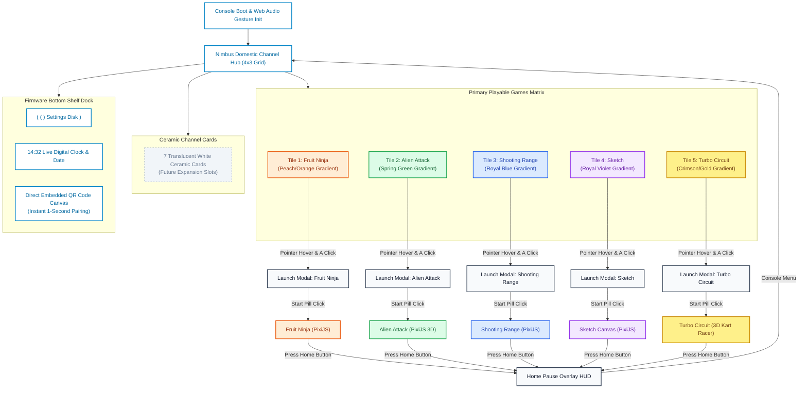

---

### 2.2 Controller Dynamic Input Mapping per Game
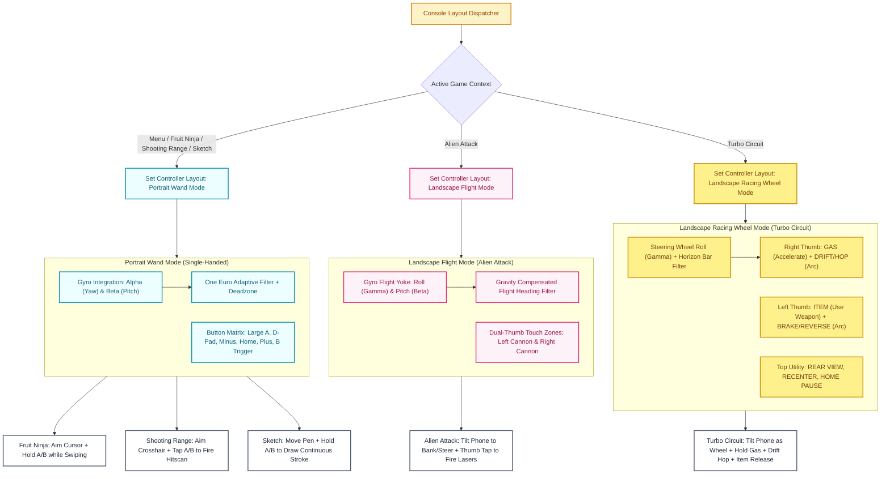

---

### 2.3 Individual Game Loops & State Machines

#### (a) Game 1: Fruit Ninja Loop
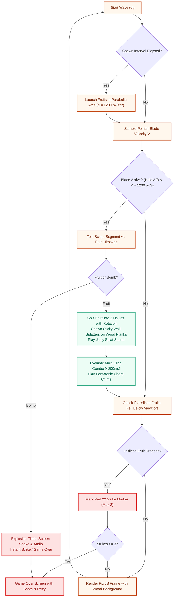

#### (b) Game 2: Alien Attack (3D Cosmic Rail Shooter) Loop
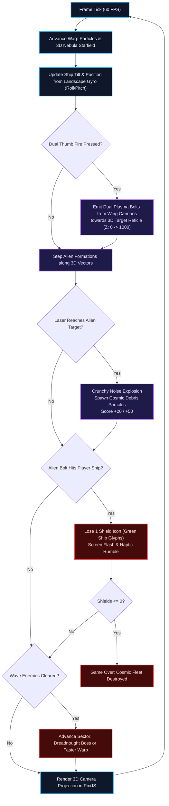

#### (c) Game 3: Shooting Range Loop
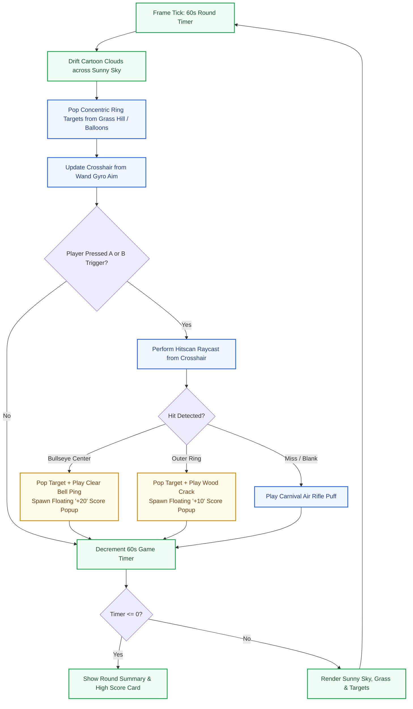

#### (d) Game 4: Sketch Loop
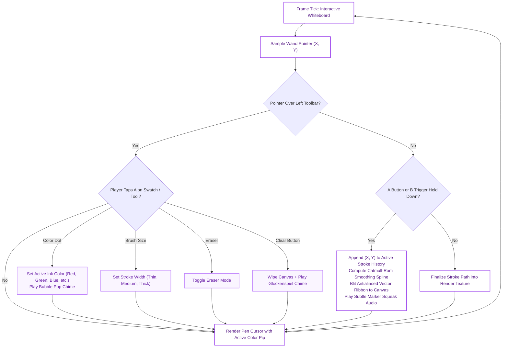

#### (e) Game 5: Turbo Circuit (3D Kart Racer Architecture)

##### 1. Master Race State Machine
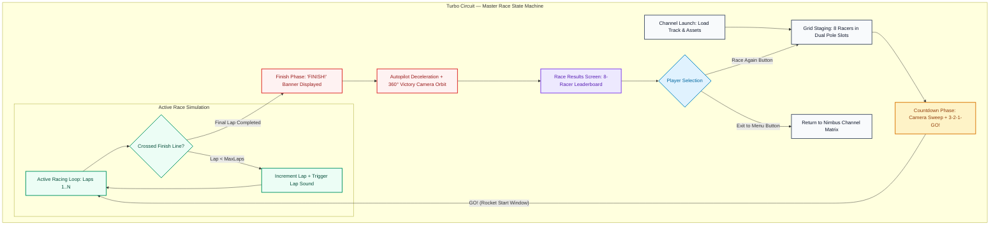

##### 2. Per-Frame Game Loop (60 FPS)
```mermaid
flowchart TD
    classDef inputStyle fill:#e0e7ff,stroke:#4338ca,stroke-width:2px,color:#312e81;
    classDef physStyle fill:#dcfce7,stroke:#15803d,stroke-width:2px,color:#14532d;
    classDef aiStyle fill:#fef3c7,stroke:#b45309,stroke-width:2px,color:#78350f;
    classDef itemStyle fill:#fce7f3,stroke:#be185d,stroke-width:2px,color:#831843;
    classDef camStyle fill:#ccfbf1,stroke:#0f766e,stroke-width:2px,color:#134e4a;
    classDef renderStyle fill:#f1f5f9,stroke:#334155,stroke-width:2px,color:#0f172a;

    Tick["Frame Tick (dt <= 16.6ms)"]:::inputStyle --> PollIn["1. Ingest Landscape Tilt (Roll) & Touch Buttons (Gas, Drift, Item, Brake)"]:::inputStyle
    
    subgraph PhysicsPass["2. Player Physics & State Machine"]
        PollIn --> SurfaceCheck["Sample Track Spline: Surface Type (Tarmac, Offroad, Boost, Glider)"]:::physStyle
        SurfaceCheck --> IntegratePhysics["Integrate Drive Force, Friction, Aerodynamic Drag & Gravity"]:::physStyle
        IntegratePhysics --> DriftState["Evaluate Drift State & Charge Mini-Turbo Sparks (Blue/Orange/Purple)"]:::physStyle
        DriftState --> GliderState["Evaluate Glider Aerodynamics (Lift, Pitch Dive/Climb, Bank)"]:::physStyle
    end

    subgraph AIPass["3. AI Racers Simulation (x7)"]
        GliderState --> AISplineFollow["Follow Target Waypoints with Lane Offsets"]:::aiStyle
        AISplineFollow --> AIRubberBand["Apply Rubber-Band Speed Multiplier vs Player Gap"]:::aiStyle
        AIRubberBand --> AIAvoid["Obstacle & Hazard Raycast Avoidance"]:::aiStyle
    end

    subgraph ItemCollisionPass["4. Items, Hazards & Collisions"]
        AIAvoid --> UpdateProjectiles["Step Kinetic Orbs, Dropped Slime & Ricochet Discs"]:::itemStyle
        UpdateProjectiles --> KartCollisions["Resolve Kart-to-Kart Bumpers & Kart-to-Hazard Spin-outs"]:::itemStyle
        KartCollisions --> ItemBoxPickups["Detect Item Box Roulette Triggers"]:::itemStyle
    end

    subgraph CameraRenderPass["5. Camera & Visual Presentation"]
        ItemBoxPickups --> UpdateChaseCam["Update Spring-Damped Chase Camera & Dynamic Speed FOV"]:::camStyle
        UpdateChaseCam --> RenderScene["Render 3D Track Projection, Billboards, Particles & Audio"]:::renderStyle
        RenderScene --> UpdateHUD["Update HUD: Gold Placement, Minimap, Coins & Laps"]:::renderStyle
    end

    UpdateHUD --> Tick
```

##### 3. Kart Physics & Drifting Mechanics
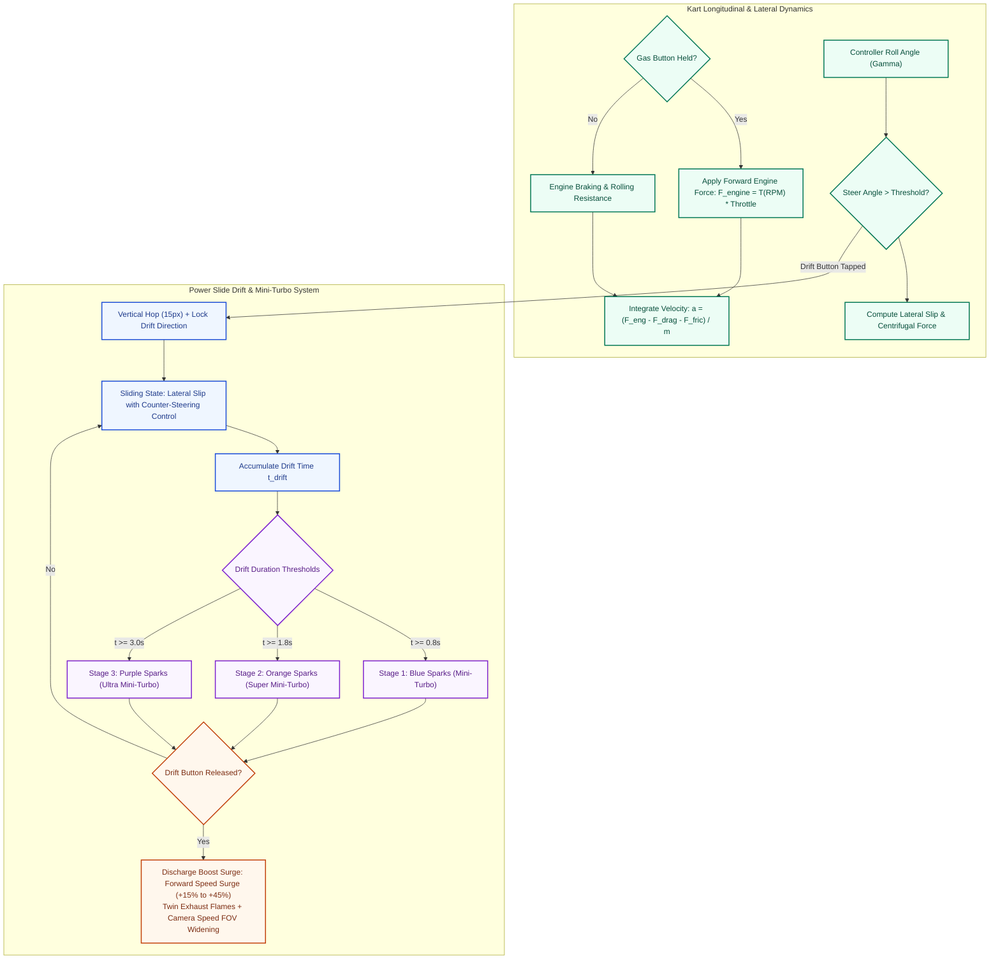

##### 4. AI Opponent Pathing with Rubber-Banding
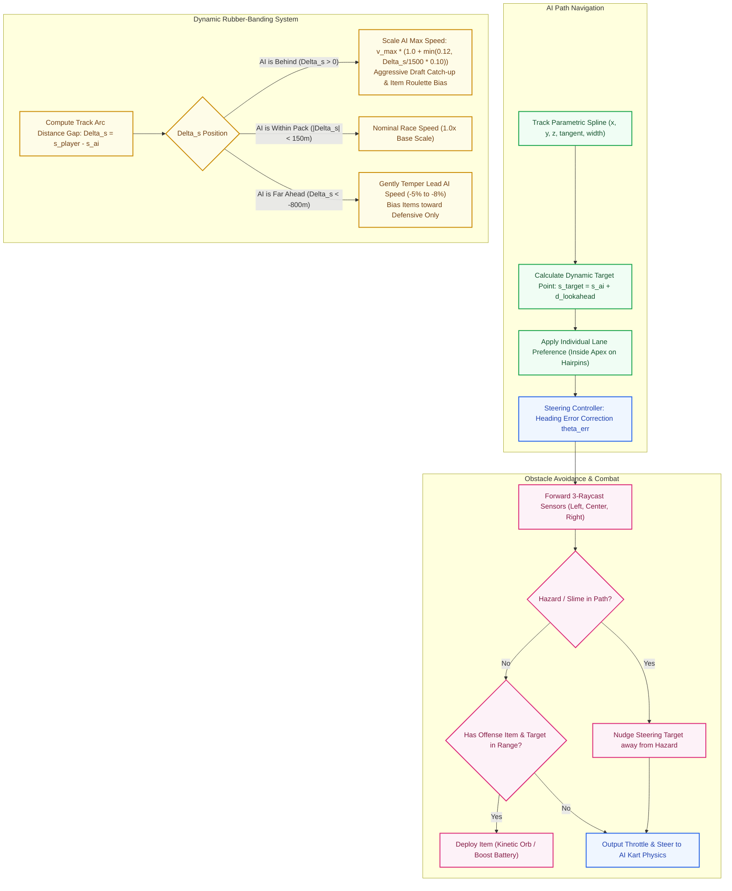

##### 5. Item System Architecture
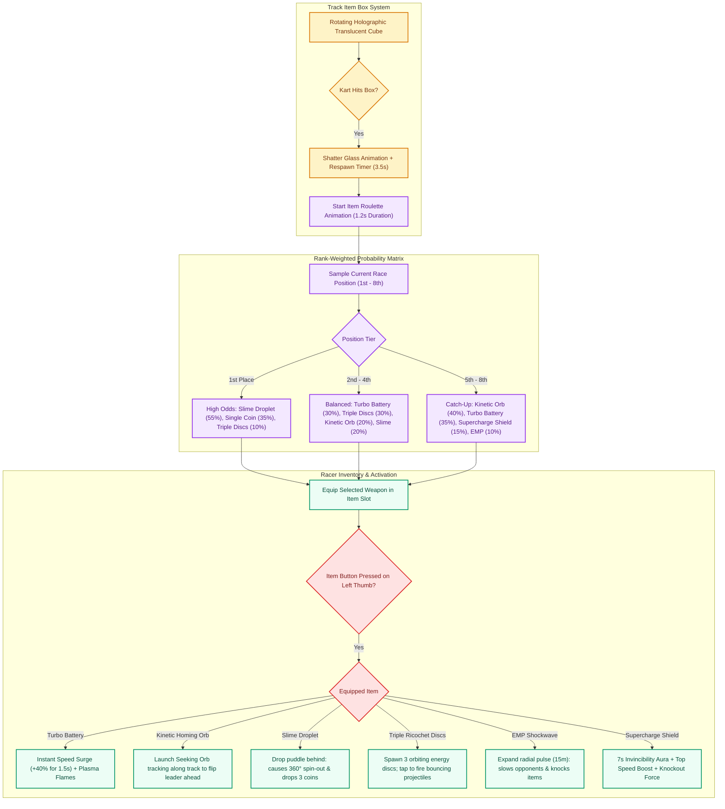

##### 6. Glider Ramp Section Architecture
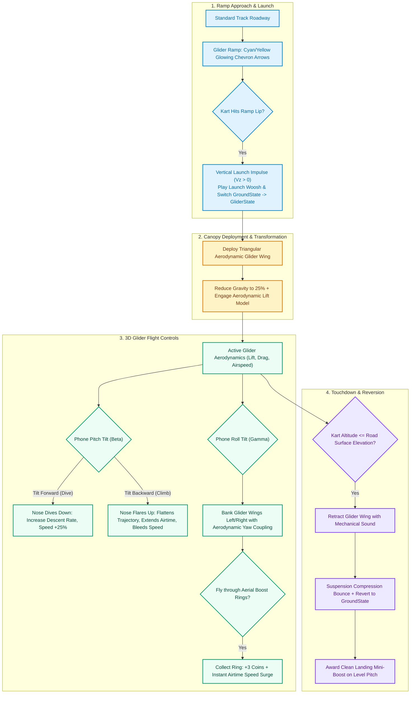

##### 7. Camera System Architecture
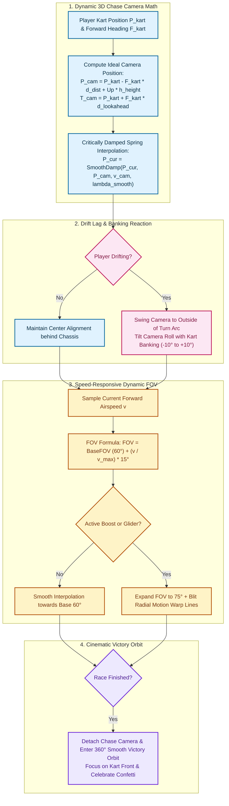

##### 8. Phone Landscape Controller Input Mapping (Turbo Circuit)
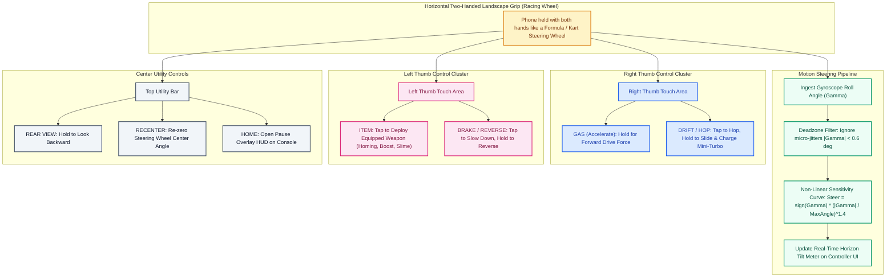

##### 9. HUD Layout Architecture
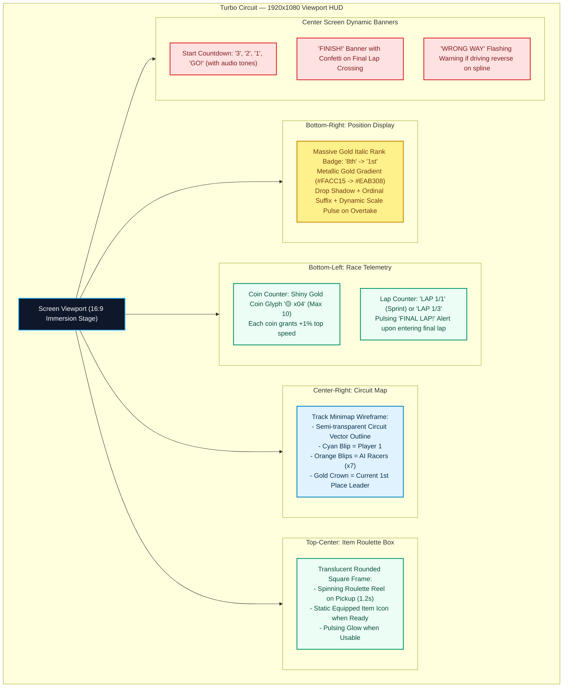

##### 10. Track Data Pipeline
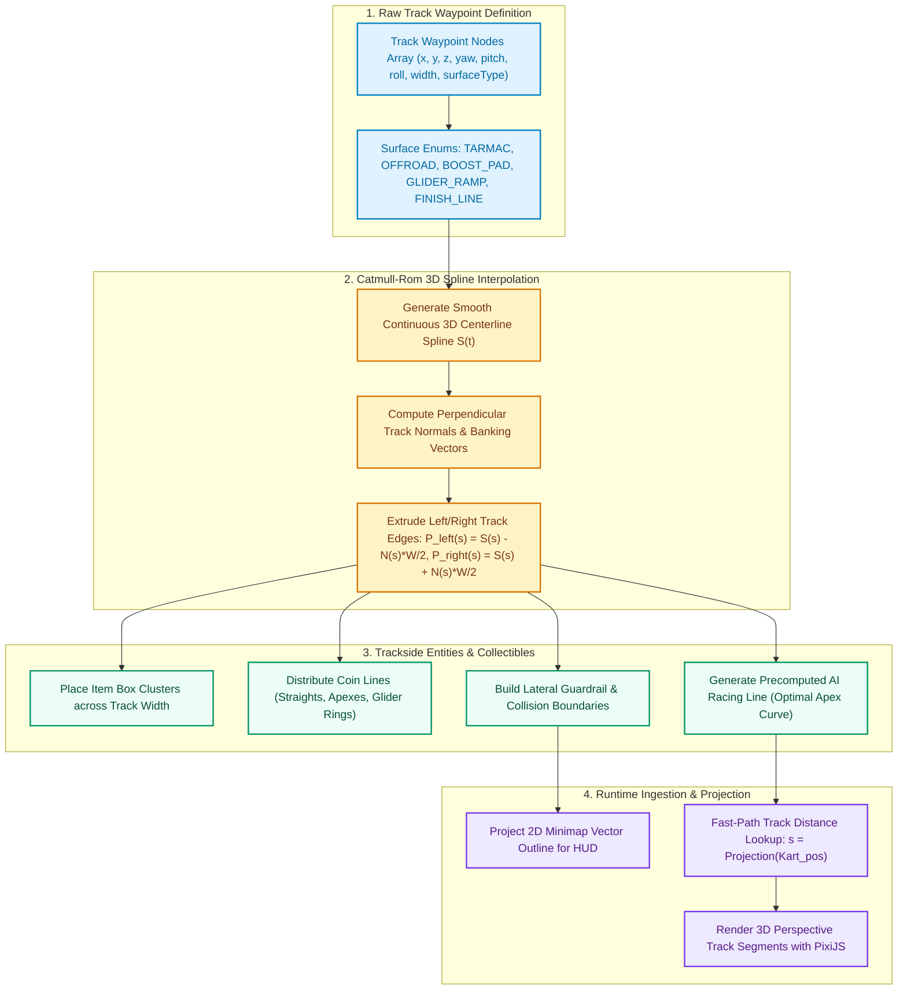

---

### 2.4 Remake Engineering Roadmap
```mermaid
flowchart LR
    classDef done fill:#ecfdf5,stroke:#059669,stroke-width:2px,color:#065f46;
    classDef active fill:#eff6ff,stroke:#2563eb,stroke-width:2px,color:#1e40af;
    classDef future fill:#f8fafc,stroke:#64748b,stroke-width:2px,color:#334155;

    R0["✔ Phase R0: Reference Spec & Master Architecture"]:::done --> R1["✔ Phase R1: Menu 4-Tile Grid & Direct QR Dock"]:::done
    R1 --> R2["✔ Phase R2: Controller Landscape Flight Mode"]:::done
    R2 --> R3["✔ Phase R3: Fruit Ninja Cedar Wall & Slicing Remake"]:::done
    R3 --> R4["✔ Phase R4: Alien Attack 3D Rail Cosmic Shooter"]:::done
    R4 --> R5["✔ Phase R5: Shooting Range Carnival Targets"]:::done
    R5 --> R6["✔ Phase R6: Sketch Interactive Whiteboard"]:::done
    R6 --> R7["✔ Phase R7: System Integration, Latency & QA Sign-off"]:::done
    R7 --> R8["✔ Phase R8: 5th Game (Turbo Circuit) Architecture & Spec"]:::done
    R8 --> R9["Phase R9: Turbo Circuit 3D Kart Racer Implementation"]:::future
```

---

## 3. Complete TypeScript Protocol Extensions

To support dynamic orientation and two-handed controls, the protocol is extended with layout modes:

```ts
/**
 * Controller Layout Configuration
 */
export type ControllerLayoutMode = 'portrait' | 'landscape';

export interface SetLayoutMessage extends BaseMessage {
  type: 'SET_LAYOUT';
  mode: ControllerLayoutMode;
  gameId?: 'fruit-ninja' | 'alien-attack' | 'shooting-range' | 'sketch' | 'turbo-circuit' | 'menu';
}

/**
 * Extended Button State supporting Landscape Dual-Thumb Controls
 */
export interface ControllerButtonState {
  a: boolean;         // Primary trigger / select (portrait) / Right thumb GAS (landscape racing)
  b: boolean;         // Underside trigger (portrait) / Left thumb BRAKE (landscape racing)
  dpadUp: boolean;
  dpadDown: boolean;
  dpadLeft: boolean;
  dpadRight: boolean;
  plus: boolean;      // + button / DRIFT (landscape racing)
  minus: boolean;     // - button / ITEM (landscape racing)
  home: boolean;      // Home overlay menu
  btn1: boolean;      // 1 button / Rear view alternate
  btn2: boolean;      // 2 button / Recenter alternate
  recenter: boolean;  // Recenter anchor button
}
```

---

## 4. Mathematical Models & Physics

### 4.1 Landscape Flight Steering Model (Alien Attack)
In landscape mode, the phone is held horizontally. Angular rates are re-projected onto flight coordinates:
$$\Delta \text{Yaw}_{\text{flight}} = -\omega_\gamma \cdot \Delta t \quad (\text{lateral phone tilt / roll banking})$$
$$\Delta \text{Pitch}_{\text{flight}} = -\omega_\beta \cdot \Delta t \quad (\text{forward/back phone tilt})$$

The starship position and aim reticle are updated with elastic centering:
$$X_{\text{ship}}(t + \Delta t) = X_{\text{ship}}(t) + \Delta \text{Yaw}_{\text{flight}} \cdot S_{\text{flight}} - k_{\text{center}} \cdot (X_{\text{ship}} - X_{\text{mid}}) \cdot \Delta t$$
$$Y_{\text{ship}}(t + \Delta t) = Y_{\text{ship}}(t) + \Delta \text{Pitch}_{\text{flight}} \cdot S_{\text{flight}} - k_{\text{center}} \cdot (Y_{\text{ship}} - Y_{\text{mid}}) \cdot \Delta t$$

### 4.2 Catmull-Rom Stroke Smoothing (Sketch)
Given sampled points $P_{i-1}, P_i, P_{i+1}, P_{i+2}$, intermediate spline points are calculated:
$$P(t) = \frac{1}{2} \left[ (2P_i) + (-P_{i-1} + P_{i+1})t + (2P_{i-1} - 5P_i + 4P_{i+1} - P_{i+2})t^2 + (-P_{i-1} + 3P_i - 3P_{i+1} + P_{i+2})t^3 \right]$$
for $t \in [0, 1]$, producing silky, rounded vector strokes with zero polygonal creasing.

### 4.3 Kart Physics, Friction & Aerodynamic Drag (Turbo Circuit)
The longitudinal motion of the kart is modeled via net tractive force:
$$F_{\text{net}} = F_{\text{traction}} - F_{\text{drag}} - F_{\text{roll}} - F_{\text{brake}}$$
where:
$$F_{\text{traction}} = \tau_{\text{engine}}(\text{RPM}) \cdot \frac{G_{\text{ratio}}}{R_{\text{wheel}}} \cdot u_{\text{gas}}, \quad F_{\text{drag}} = \frac{1}{2} C_d \rho A_{\text{kart}} v^2, \quad F_{\text{roll}} = \mu_{\text{surface}} m g$$

Surface friction coefficient $\mu_{\text{surface}}$ adapts dynamically:
- Tarmac: $\mu = 0.015$ (high grip, nominal roll resistance)
- Off-road (grass/dirt): $\mu = 0.120$ (heavy drag penalty unless boosted)
- Boost Pad: $+8000\,\text{N}$ forward tractive impulse for $1.2\,\text{s}$

Lateral slip velocity and centrifugal force dictate drift dynamics:
$$F_{\text{centrifugal}} = \frac{m v^2}{R_{\text{curve}}}, \quad v_{\text{lateral}} = \vec{v} \cdot \hat{n}_{\text{lateral}}$$
During drift mode, lateral grip drops to $30\%$, enabling sustained power-sliding with counter-steer control.

### 4.4 Glider Flight Aerodynamics & Lift/Drag Polar (Turbo Circuit)
When launching off a glider ramp, aerodynamic lift balances kart gravity:
$$L = \frac{1}{2} C_L(\alpha_{\text{pitch}}) \rho v^2 A_{\text{wing}}, \quad D = \frac{1}{2} C_D(\alpha_{\text{pitch}}) \rho v^2 A_{\text{wing}}$$
where $\alpha_{\text{pitch}}$ is derived from the player's phone forward/backward tilt:
- **Diving ($\alpha < 0$)**: $C_L$ decreases, airspeed $v$ increases by $+25\%$, altitude $Z$ drops rapidly.
- **Climbing / Flaring ($\alpha > 0$)**: $C_L$ increases, extending flight distance across aerial chasms while airspeed bleeds off gradually.

### 4.5 AI Opponent Rubber-Banding Velocity Scaling Model (Turbo Circuit)
To maintain thrilling pack racing while respecting fair competition, AI max speed $v_{\text{AI}}$ scales as a continuous function of arc-length distance gap $\Delta s = s_{\text{player}} - s_{\text{AI}}$ along the track spline:
$$v_{\text{AI\_target}}(\Delta s) = v_{\text{base}} \cdot \begin{cases}
1.0 + \min\left(0.12, \frac{\Delta s}{1500} \cdot 0.10\right) & \text{if } \Delta s > 0 \text{ (AI is behind)} \\
1.0 & \text{if } -800 \le \Delta s \le 0 \text{ (AI in pack)} \\
1.0 - \min\left(0.08, \frac{|\Delta s| - 800}{1500} \cdot 0.08\right) & \text{if } \Delta s < -800 \text{ (AI far ahead)}
\end{cases}$$
This ensures pack cohesion, exhilarating photo-finishes, and an achievable victory for skilled driving without immersion-breaking artificial teleportation.
