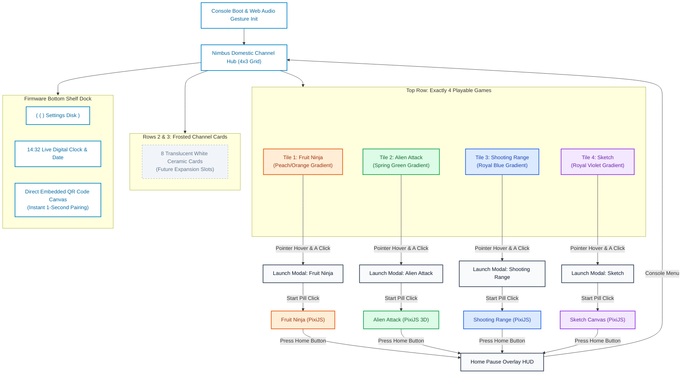
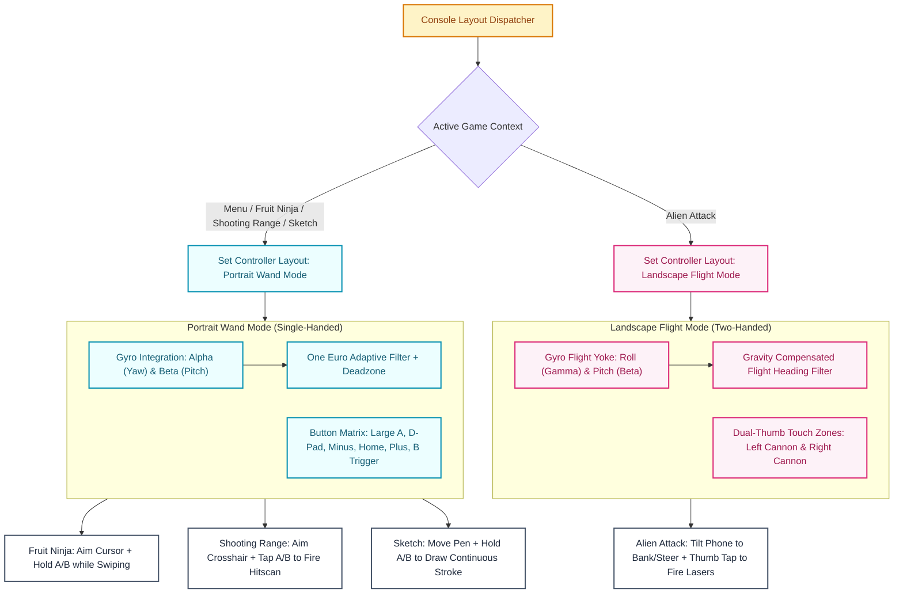
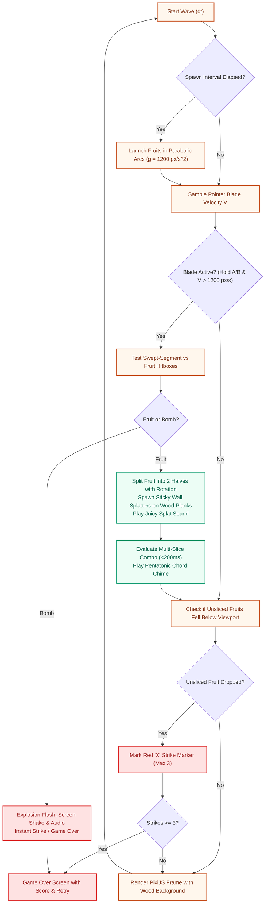
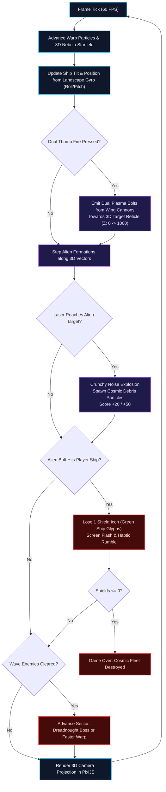
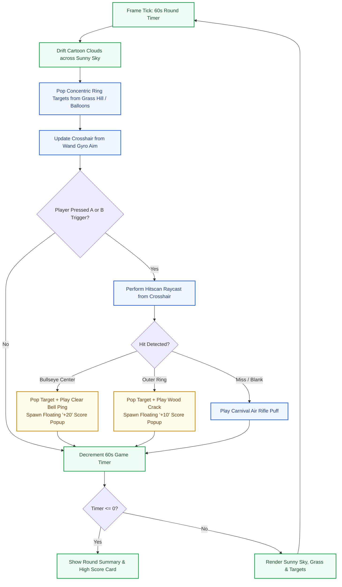
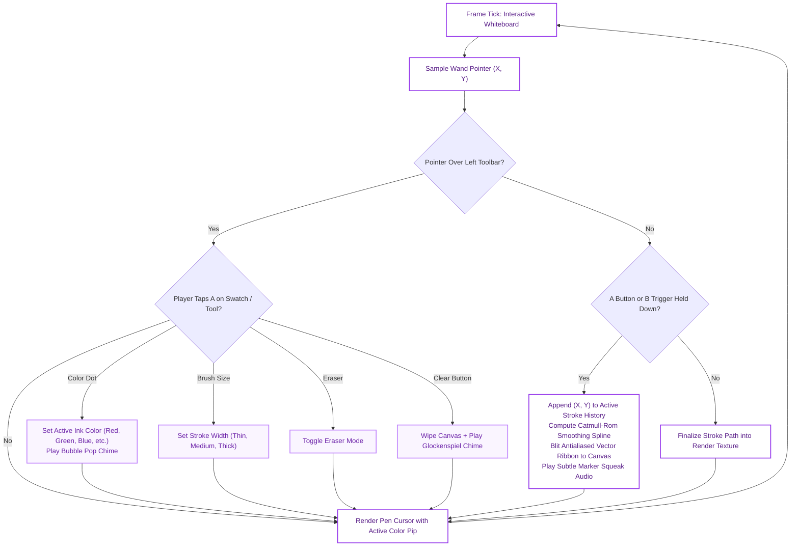

# NimbusPlay — System Architecture & Technical Specifications (Game Remake)

This document defines the technical architecture, mathematical models, module boundaries, and TypeScript interfaces for the **NimbusPlay Game Remake**, based on the reference analysis in [`docs/GAME_REFERENCE.md`](file:///Users/adityasurse/Documents/NimbusPlay/docs/GAME_REFERENCE.md) derived from `/design/reference/Video-7889.mp4`, `reel-games.png`, and `reel-menu.png`.

---

## 1. Architectural Overview & Design Tenets

NimbusPlay bridges a desktop browser terminal with an Android smartphone motion controller over an ultra-low-latency local WebSocket mesh:
1. **Console Host Terminal**: A desktop browser running Vite, rendering the authentic domestic console shell (4×3 Channel Matrix) via semantic DOM/CSS and hardware-accelerated games via PixiJS v8.
2. **Motion Input Terminal (Nimbus Wand)**: An Android smartphone running Chrome Mobile, capturing inertial measurements (`DeviceMotionEvent`) and multi-touch interactions at 60Hz.
3. **Dynamic Layout Switching**: The controller dynamically adapts its UI between **Portrait Wand Mode** (for Menu, Fruit Ninja, Shooting Range, Sketch) and **Landscape Flight Mode** (for Alien Attack).
4. **Local Transport Relay**: Lightweight Node.js WebSocket relay bridging controller and console over the local Wi-Fi subnet with sub-10ms packet transport.

```
+----------------------------------------------------------------------------------+
|                              LOCAL WI-FI NETWORK                                 |
|                                                                                  |
|  +-------------------------+             +------------------------------------+  |
|  |     Android Phone       |   HTTPS     |       Laptop / Workstation         |  |
|  |  (Chrome 110+ Mobile)   |<===========>|  Vite Dev Server (Port 5173/HTTPS) |  |
|  |                         |  Web Assets |  + basic-ssl self-signed cert     |  |
|  |  [Portrait Wand /       |             +-----------------+------------------+  |
|  |   Landscape Flight UI]  |                               |                      |
|  |  [Gyro & Accelerometer] |                               | Proxy /ws            |
|  +------------+------------+                               |                      |
|               |                                            v                      |
|               | Secure WebSocket (WSS)            +-----------------+             |
|               +==================================>| Node WS Relay   |             |
|                               <===================| (Port 3001)     |             |
|                                                   +--------+--------+             |
|                                                            |                      |
|                                                            | Loopback WS          |
|                                                            v                      |
|                                                   +-----------------+             |
|                                                   | Console Client  |             |
|                                                   | (Desktop Tab)   |             |
|                                                   | - Pointer Eng.  |             |
|                                                   | - Channel Shell |             |
|                                                   | - 4 Pixi Games  |             |
|                                                   | - Web Audio     |             |
|                                                   +-----------------+             |
+----------------------------------------------------------------------------------+
```

---

## 2. Colorful System Diagrams (Mermaid)

### 2.1 Remake Channel Menu Flow & 4 Game Matrix


---

### 2.2 Controller Dynamic Input Mapping per Game


---

### 2.3 Individual Game Loops & State Machines

#### (a) Game 1: Fruit Ninja Loop


#### (b) Game 2: Alien Attack (3D Cosmic Rail Shooter) Loop


#### (c) Game 3: Shooting Range Loop


#### (d) Game 4: Sketch Loop


---

### 2.4 Remake Engineering Roadmap

```mermaid
flowchart LR
    classDef done fill:#ecfdf5,stroke:#059669,stroke-width:2px,color:#065f46;
    classDef active fill:#eff6ff,stroke:#2563eb,stroke-width:2px,color:#1e40af;
    classDef future fill:#f8fafc,stroke:#64748b,stroke-width:2px,color:#334155;

    R0["✔ Phase R0: Reference Spec & Master Architecture"]:::done --> R1["Phase R1: Menu 4-Tile Grid & Direct QR Dock"]:::active
    R1 --> R2["Phase R2: Controller Landscape Flight Mode"]:::future
    R2 --> R3["Phase R3: Fruit Ninja Cedar Wall & Slicing Remake"]:::future
    R3 --> R4["Phase R4: Alien Attack 3D Rail Cosmic Shooter"]:::future
    R4 --> R5["Phase R5: Shooting Range Carnival Targets"]:::future
    R5 --> R6["Phase R6: Sketch Interactive Whiteboard"]:::future
    R6 --> R7["Phase R7: Final Polish, Latency & QA Sign-off"]:::future
```


---

## 3. Complete TypeScript Protocol Extensions

To support dynamic orientation and two-handed controls, the protocol is extended with layout modes:

```ts
/**
 * Controller Layout Configuration
 */
export type ControllerLayoutMode = 'portrait' | 'landscape';

export interface SetLayoutMessage extends BaseMessage {
  type: 'SET_LAYOUT';
  mode: ControllerLayoutMode;
  gameId?: 'fruit-ninja' | 'alien-attack' | 'shooting-range' | 'sketch' | 'menu';
}

/**
 * Extended Button State supporting Landscape Dual-Thumb Controls
 */
export interface ControllerButtonState {
  a: boolean;         // Primary trigger / select (portrait) / Right thumb (landscape)
  b: boolean;         // Underside trigger (portrait) / Left thumb (landscape)
  dpadUp: boolean;
  dpadDown: boolean;
  dpadLeft: boolean;
  dpadRight: boolean;
  plus: boolean;      // + button
  minus: boolean;     // - button
  home: boolean;      // Home overlay menu
  btn1: boolean;      // 1 button / Left thumb alternate
  btn2: boolean;      // 2 button / Right thumb alternate
  recenter: boolean;  // Recenter anchor button
}
```

---

## 4. Mathematical Models & Physics

### 4.1 Landscape Flight Steering Model (Alien Attack)
In landscape mode, the phone is held horizontally. Angular rates are re-projected onto flight coordinates:
$$\Delta \text{Yaw}_{\text{flight}} = -\omega_\gamma \cdot \Delta t \quad (\text{lateral phone tilt / roll banking})$$
$$\Delta \text{Pitch}_{\text{flight}} = -\omega_\beta \cdot \Delta t \quad (\text{forward/back phone tilt})$$

The starship position and aim reticle are updated with elastic centering:
$$X_{\text{ship}}(t + \Delta t) = X_{\text{ship}}(t) + \Delta \text{Yaw}_{\text{flight}} \cdot S_{\text{flight}} - k_{\text{center}} \cdot (X_{\text{ship}} - X_{\text{mid}}) \cdot \Delta t$$
$$Y_{\text{ship}}(t + \Delta t) = Y_{\text{ship}}(t) + \Delta \text{Pitch}_{\text{flight}} \cdot S_{\text{flight}} - k_{\text{center}} \cdot (Y_{\text{ship}} - Y_{\text{mid}}) \cdot \Delta t$$

### 4.2 Catmull-Rom Stroke Smoothing (Sketch)
Given sampled points $P_{i-1}, P_i, P_{i+1}, P_{i+2}$, intermediate spline points are calculated:
$$P(t) = \frac{1}{2} \left[ (2P_i) + (-P_{i-1} + P_{i+1})t + (2P_{i-1} - 5P_i + 4P_{i+1} - P_{i+2})t^2 + (-P_{i-1} + 3P_i - 3P_{i+1} + P_{i+2})t^3 \right]$$
for $t \in [0, 1]$, producing silky, rounded vector strokes with zero polygonal creasing.
